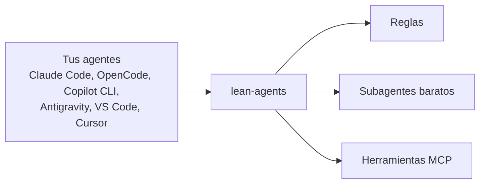

<div align="center">


# lean-agents

**El instalador de las herramientas que ahorran tokens y estiran tu presupuesto mientras usas varios agentes de código a la vez.**

[](LICENSE) [](https://github.com/estebanmr99/lean-agents/actions/workflows/ci.yml) [](https://github.com/estebanmr99/lean-agents/actions/workflows/secret-scan.yml) 

[Read in English](README.md)

</div>

Se instala sobre los agentes y CLIs que ya usas y mejora cómo trabajan: reglas `AGENTS.md` / `CLAUDE.md`, subagentes baratos, herramientas MCP que ahorran contexto y presets de privacidad.

```bash
npx lean-agents@latest --dry-run
```

`--dry-run` lista cada archivo y comando antes; nada cambia. Sin `npx`, Windows PowerShell y todas las opciones: [Inicio rápido](#inicio-rápido).


## Agentes compatibles

| Agente | macOS | Linux | Windows | Reglas | Subagentes | Herramientas MCP | Job de CI con binario real |
| --- | --- | --- | --- | --- | --- | --- | --- |
| Claude Code | VERIFY | ✅ | VERIFY | ✅ | ✅ | ✅ | `real-claude` |
| OpenCode 1.x | VERIFY | ✅ | ✅ | ✅ | ✅ | ✅ | `real-opencode-v1`, `real-windows` |
| OpenCode 2.x | VERIFY | ✅ | VERIFY | ✅ | ✅ | ✅ | `real-opencode` |
| Copilot CLI | ✅ | ✅ | ✅ | ✅ | ✅ | ✅ | `real-copilot`, `real-copilot-windows` |
| Antigravity CLI | ✅ | ✅ | ✅ | ⚠️ | ✅ | ✅ | `real-antigravity`, `real-antigravity-windows` |
| VS Code Copilot | ✅ | ✅ | VERIFY | ⚠️ | ⚠️ | ✅ | `real-vscode` |
| Cursor | VERIFY | ✅ | ✅ | ➖ (solo con `--project`) | ⚠️ | ✅ | `real-cursor`, `real-cursor-windows` |

✅ un job de CI ejecuta el binario real en ese sistema (columnas de sistema) o lean-agents lo escribe (columnas de función) · ⚠️ escrito, carga sin comprobar · ➖ no disponible · VERIFY aún sin comprobar. Archivos por agente y fechas de verificación: [docs/compatibility.md](docs/compatibility.md).

## De un vistazo

- **Reglas:** un único conjunto corto de reglas globales, generado para cada agente.
- **Subagentes baratos:** exploración, investigación y revisión corren en el nivel de modelo más barato que sirva.
- **Herramientas que ahorran contexto:** RTK, Context Mode, Serena y Playwright MCP.
- **Presets de privacidad:** `--privacy strict` u `off` para telemetría, actualizaciones y llamadas salientes.



**Para quién es:** desarrolladores solos · equipos (`--project` escribe la configuración en el repo) · PCs de trabajo detrás de un proxy ([detalles](#en-una-pc-de-trabajo-proxy-red-y-revisión-de-seguridad)).

<!-- details -->
## Detalles

lean-agents funciona con Claude Code, OpenCode 1.x y 2.x, GitHub Copilot CLI, Antigravity CLI, VS Code Copilot y Cursor en macOS, Linux y Windows. Dale una estrella al repo para enterarte cuando salga `v1.0.0`.

**Contenido**

- [Demo: OpenCode con modelos de GitHub Copilot](#demo-opencode-con-modelos-de-github-copilot)
- [Inicio rápido](#inicio-rápido)
- [Por qué](#por-qué) · [Qué incluye](#qué-incluye)
- [Warp y Orca](#warp-y-orca) · [Navegador con tu sesión](#navegador-con-tu-sesión-opcional) · [VS Code Copilot y Cursor](#vs-code-copilot-y-cursor)
- [Modo equipo](#modo-equipo---project) · [Migrar](#migrar-desde-otra-herramienta---migrate) · [Sesiones de agentes en paralelo](#sesiones-de-agentes-en-paralelo) · [Claude a través de GitHub Copilot](#claude-a-través-de-github-copilot)
- [Niveles de instalación](#niveles-de-instalación) · [En una PC de trabajo](#en-una-pc-de-trabajo-proxy-red-y-revisión-de-seguridad) · [Modelos siempre al día](#modelos-siempre-al-día)
- [Seguridad](#seguridad) · [Créditos](#créditos) · [Hoja de ruta](#hoja-de-ruta) · [Contribuir](#contribuir) · [Licencia](#licencia)

## Demo: OpenCode con modelos de GitHub Copilot

1. Instala OpenCode. macOS, Linux o Git Bash:
   ```bash
   curl -fsSL https://opencode.ai/v2/install | bash
   ```
   Windows PowerShell (el script oficial corre con Git Bash y solo edita `~/.bashrc`, así que esto agrega la carpeta al PATH de tu usuario; abre una terminal nueva después):
   ```powershell
   curl.exe -fsSL https://opencode.ai/v2/install -o "$env:TEMP\opencode-install.sh"
   & "$env:ProgramFiles\Git\bin\bash.exe" -l (($env:TEMP -replace '\\','/') + '/opencode-install.sh') --no-modify-path
   $bin = "$HOME\.opencode\bin"; $u = [Environment]::GetEnvironmentVariable('Path','User')
   if (($u -split ';') -notcontains $bin) { [Environment]::SetEnvironmentVariable('Path', "$u;$bin", 'User') }
   opencode --version
   ```
2. Mira qué cambiaría lean-agents (`--yes` acepta los valores por defecto, así la vista previa no pregunta). macOS, Linux o Git Bash:
   ```bash
   curl -fsSL https://github.com/estebanmr99/lean-agents/releases/latest/download/install.sh | bash -s -- --agents opencode-v2 --profile github-copilot --dry-run --yes
   ```
   Windows PowerShell:
   ```powershell
   & ([scriptblock]::Create((irm https://github.com/estebanmr99/lean-agents/releases/latest/download/install.ps1))) -Agents opencode-v2 -Profile github-copilot -DryRun -Yes
   ```
3. Corre lo mismo sin el dry run; en una terminal te hace las preguntas que saltaste con `--yes`. macOS, Linux o Git Bash:
   ```bash
   curl -fsSL https://github.com/estebanmr99/lean-agents/releases/latest/download/install.sh | bash -s -- --agents opencode-v2 --profile github-copilot
   ```
   Windows PowerShell:
   ```powershell
   & ([scriptblock]::Create((irm https://github.com/estebanmr99/lean-agents/releases/latest/download/install.ps1))) -Agents opencode-v2 -Profile github-copilot
   ```
4. Abre `opencode`, ejecuta `/connect`, elige GitHub Copilot e inicia sesión con tu cuenta de GitHub (necesita un plan de Copilot). lean-agents nunca maneja el inicio de sesión.
   - Los subagentes usan el perfil `github-copilot`: `fast` = claude-haiku-5.5, `balanced` = claude-sonnet-5.5, `strong` = claude-opus-5.5.
   - No se usan modelos gratuitos de OpenCode.
5. Revisa el resultado:
   ```bash
   curl -fsSL https://github.com/estebanmr99/lean-agents/releases/latest/download/install.sh | bash -s -- --doctor
   ```

Las demos para Claude Desktop y Cursor vienen después.

## Inicio rápido

En cualquier sistema con Node.js 22.20+ y git (macOS, Linux, Windows):

```bash
npx lean-agents@latest --dry-run
```

El mismo comando ejecuta `--doctor`, `--update` (siempre la versión más nueva) y `--uninstall`; `npx lean-agents --version` muestra la versión. npm comprueba la integridad del paquete.

Los bootstraps de abajo descargan el último release, lo comprueban con el `SHA256SUMS` del release y solo entonces lo ejecutan (`LEAN_AGENTS_VERSION=0.7.0` fija un release). Ya instalado, `--dry-run`, `--doctor` y `--uninstall` no usan la red. Un checkout local (`bash install.sh` desde un clon) se confía tal cual; solo la descarga del release se comprueba con checksum.

macOS, Linux o Git Bash:

```bash
curl -fsSL https://github.com/estebanmr99/lean-agents/releases/latest/download/install.sh | bash -s -- --dry-run
```

Windows PowerShell:

```powershell
& ([scriptblock]::Create((irm https://github.com/estebanmr99/lean-agents/releases/latest/download/install.ps1))) -DryRun
```

¿Prefieres que lo haga tu agente? Pega esto en Claude Code, OpenCode o Copilot CLI ([la guía](docs/install-with-an-agent.md) tiene los pasos y la salida `--json`):

```text
Instala lean-agents por mí desde https://github.com/estebanmr99/lean-agents.
Sigue docs/install-with-an-agent.md de ese repo. Pregunta antes de cada cambio.
Nunca leas, muestres ni guardes mis claves o tokens, y nunca corras gh auth login por mí.
```

Para actualizar después, pega esto (el skill `lean-update` se instala con lean-agents; sin él, el agente lee [la guía](docs/install-with-an-agent.md#update-with-an-agent)). También sirve para una instalación hecha a mano:

```text
Actualiza lean-agents por mí desde https://github.com/estebanmr99/lean-agents.
Usa el skill lean-update, o sigue docs/install-with-an-agent.md "Update with an agent". Muéstrame primero una tabla y pregunta antes de cada cambio.
Nunca leas, muestres ni guardes mis claves o tokens.
```

Usa `--lang es` para que las reglas y las respuestas queden en español.

Empieza siempre con `--dry-run`: muestra cada archivo y comando antes de cambiar nada. Luego córrelo otra vez sin `--dry-run`; te pregunta qué agentes, herramientas, nivel de privacidad, idioma y perfil de modelos quieres.

- Opciones útiles: `--all-tools`, `--privacy strict`, `--lang es`, `--profile vertex-gemini`, `--update`, `--uninstall`, `--doctor`, `--json` (con `--dry-run` o `--doctor`, para agentes) (`--help` las lista todas).
- En PowerShell las opciones comunes van en PascalCase: `-DryRun`, `-AllTools`, `-Privacy strict`, `-Profile vertex-gemini`. Cualquier otra opción se pasa tal cual, por ejemplo `-DryRun --network off`.
- Context Mode 2 necesita Node.js 24.15 y GSD Core necesita Node.js 24 (`engines.node` en `core/pins.json`). Con un Node activo más antiguo, lean-agents los ejecuta con un Node 24 de nvm sin cambiar tu Node por defecto (nvm-windows: uno ya instalado) y lo registra con su ruta absoluta; en Claude Code eso significa un servidor MCP en lugar del plugin de Context Mode, así que sus hooks y skills no se instalan. Sin nvm los omite con una línea. Todo lo demás funciona con Node.js 22.20 o superior.
- Con Context Mode, el instalador también instala Bun por defecto (`ctx_execute` más rápido); añade `--no-bun` (`-NoBun` en PowerShell) para omitirlo. Con Antigravity, `--no-app` (`-NoApp`) omite la instalación de la app. Ver la fila de Bun en [Niveles de instalación](#niveles-de-instalación).

## Por qué

- **Menos tokens.** Explorar, investigar y revisar lo hacen subagentes baratos. Las salidas grandes no entran al contexto. Los agentes buscan símbolos en vez de leer archivos completos.
- **Respuestas más claras.** Un solo set corto de reglas: primero la respuesta, supuestos explícitos, cambios quirúrgicos, verificar antes de decir que terminó.
- **Igual en todos lados.** Las reglas se escriben una vez en `core/` y se adaptan a cada agente.

## Qué incluye

| Función | Claude Code | OpenCode 2.x | OpenCode 1.x | Copilot CLI | Antigravity CLI |
| --- | --- | --- | --- | --- | --- |
| Reglas globales (AGENTS.md) | ✅ | ✅ | ✅ | ✅ | ⚠️ se escriben, carga sin probar |
| Subagentes por costo | ✅ | ✅ | ✅ | ✅ | ✅ flash, pro |
| RTK (comprime la salida del shell) | ✅ | ✅ | ✅ | ✅ | ✅ |
| Context Mode | ✅ plugin | ✅ MCP | ✅ plugin | ✅ plugin | ✅ plugin |
| Serena + Playwright MCP | ✅ | ✅ | ✅ | ✅ | ✅ |
| Navegador con tu sesión (opcional) | ➖ Claude in Chrome | ✅ opcional | ✅ opcional | ✅ opcional | ➖ |
| Ponytail | ✅ | ✅ | ✅ | ➖ | ➖ |
| i-have-adhd | ✅ | ✅ | ✅ | ✅ | ⚠️ se escribe, carga sin probar |
| Caveman y otras skills | ✅ | ✅ | ✅ | ✅ | ⚠️ se escriben, carga sin probar |
| Compactación de contexto | ✅ auto 80% | ✅ nativa | ✅ nativa, DCP opcional | ➖ | ➖ |
| Presets de red (telemetría, updates, salidas) | ✅ | ✅ updates, compartir | ✅ | ⚠️ updates; telemetría es un recordatorio | ⚠️ solo recordatorios |
| Proxy en cada comando de instalación | ✅ | ✅ | ✅ | ✅ | ⚠️ probado en CI, sin docs upstream |

✅ soportado · ⚠️ parcial · ➖ no disponible para este agente. Detalles y fechas de verificación: [docs/compatibility.md](docs/compatibility.md).

| Función | VS Code Copilot | Cursor (IDE y CLI) | Repo del equipo (`--project`) |
| --- | --- | --- | --- |
| Reglas | ⚠️ se escriben, carga sin probar | ➖ solo en ajustes, usa `--project` | ✅ `AGENTS.md` |
| Subagentes | ⚠️ se escriben, carga sin probar | ⚠️ se escriben, carga sin probar | ✅ `.github/agents`; ⚠️ `.cursor/agents` (carga en Cursor CLI sin verificar) |
| RTK | ⚠️ solo a través de Copilot CLI | ✅ | ➖ por usuario |
| Context Mode, Serena, Playwright | ✅ MCP | ✅ MCP | ✅ `.vscode/mcp.json`, `.cursor/mcp.json` |
| Navegador con tu sesión (opcional) | ✅ opcional | ✅ opcional | ➖ por usuario |
| Skills Caveman, i-have-adhd | ⚠️ se escriben, carga sin probar | ⚠️ se escriben, carga sin probar | ➖ por usuario |

**App y CLI de Antigravity.**

- La app y la CLI leen los mismos archivos de `~/.gemini/config`, así que una sola configuración sirve a ambas en macOS, Linux y Windows (la CLI en Windows se prueba en CI con `agy` real).
- Con Antigravity elegido, lean-agents instala la CLI y la app con Homebrew (macOS) o la app con winget (Windows); si no, muestra el enlace oficial.
- **VERIFY:** que la app cargue reglas, subagentes, skills y servidores MCP, dónde está su archivo MCP y sus claves de ajustes. CI no puede ejecutar la app ni iniciar sesión, así que no están probados.

## Warp y Orca

<details>
<summary>Qué añaden las integraciones de Warp y Orca</summary>

Si ya usas [Warp](https://www.warp.dev) u [Orca](https://github.com/stablyai/orca), lean-agents añade sus integraciones de agentes para los agentes que elegiste. Nunca instala las terminales. Busca la app (o `warp-terminal` / `orca` en el PATH), preselecciona lo que encuentra y no pregunta nada si no hay ninguna. `--terminal warp|orca|both|none` lo cambia; `none` lo desactiva.

- **Warp:** el plugin de Claude Code `warp@claude-code-warp` (necesita `jq`) y el plugin de OpenCode `@warp-dot-dev/opencode-warp`.
- **Orca:** la skill `orca-cli` para tus agentes. Orca gestiona sus propios hooks de estado (Settings > Agents, o `orca agent hooks on`); lean-agents no los toca, pero el primer arranque de Orca los escribe en `~/.claude/settings.json` y `~/.cursor/hooks.json`, y `--doctor` los muestra. Su Agent Session Search indexa todos los chats de agentes de la máquina y viene activado (Settings > Session History).
- **Windows:** con el preset de red todo apagado pone `DO_NOT_TRACK=1` y `ORCA_TELEMETRY_DISABLED=1` en tu entorno de usuario (solo si no existen), y detrás de un proxy añade `localhost`, `127.0.0.1` y `::1` a `NO_PROXY` para que los hooks de estado de Orca lleguen a la app. Con Git Bash añade un bloque marcado en `~/.bashrc` (los alias de `agent` de Cursor y las mismas entradas de `NO_PROXY`). `--uninstall` quita solo lo que añadió.
- Tras instalar imprime una lista «Todavía necesitas hacer tú» (login de Cursor, User Rules, **Install CLI & Skills** de Orca y el primer arranque); `--doctor` muestra la misma lista con lo ya hecho.
- `--uninstall` quita lo que añadió. Con el preset de red todo apagado imprime los interruptores de telemetría (Warp `telemetry_enabled = false`, Orca `DO_NOT_TRACK=1`) y nunca edita los ajustes de las apps.

Fuentes y datos de GUI sin verificar: [docs/compatibility.md](docs/compatibility.md#terminals).

</details>

## Navegador con tu sesión (opcional)

<details>
<summary>Cómo funciona el navegador con tu sesión</summary>

El MCP `playwright` por defecto abre un navegador nuevo sin ventana, que falla en páginas con inicio de sesión único (SSO). `--tools playwright-extension` agrega `@playwright/mcp --extension`. Se conecta a tu propio Chrome o Edge con la sesión iniciada, a través de la [extensión de Playwright](https://chromewebstore.google.com/detail/playwright-extension/mmlmfjhmonkocbjadbfplnigmagldckm).

- Instala la extensión tú mismo. Las extensiones no se pueden instalar en silencio sin una política de administrador.
- Cada sesión te pide aprobar la conexión. Aprobar solo con un token es opcional: mira [docs/browser-extension.md](docs/browser-extension.md). El instalador nunca pide, guarda ni muestra el token.
- Funciona con OpenCode, Copilot CLI, VS Code Copilot y Cursor. Claude Code y Claude Desktop usan Claude in Chrome.

</details>

## VS Code Copilot y Cursor

<details>
<summary>Qué se escribe en VS Code Copilot y Cursor</summary>

lean-agents configura el chat de Copilot en VS Code y Cursor (el editor y su CLI `agent`) igual que los demás agentes:

- **VS Code Copilot:** reglas en `~/.copilot/copilot-instructions.md`, subagentes en `~/.copilot/agents/`, servidores MCP en tu `mcp.json` de usuario de VS Code, y skills. Copilot CLI lee los mismos archivos de `~/.copilot`, así que con los dos se escriben una sola vez.
- **Cursor:** subagentes en `~/.cursor/agents/`, servidores MCP en `~/.cursor/mcp.json`, el hook de RTK y skills. Cursor guarda las reglas de usuario en su pantalla de ajustes, no en un archivo, así que lean-agents no puede escribirlas. Usa el modo equipo de abajo para darle a Cursor las reglas a través del `AGENTS.md` del repo.

```bash
curl -fsSL https://github.com/estebanmr99/lean-agents/releases/latest/download/install.sh | bash -s -- --dry-run --agents vscode-copilot,cursor
```

```powershell
& ([scriptblock]::Create((irm https://github.com/estebanmr99/lean-agents/releases/latest/download/install.ps1))) -DryRun -Agents vscode-copilot,cursor
```

Quita `--dry-run` (`-DryRun`) para aplicar. `--uninstall` lo quita todo otra vez.

</details>

## Modo equipo (`--project`)

<details>
<summary>Archivos que escribe y comandos</summary>

Pone la configuración compartida en un repositorio, así todo el equipo la recibe con `git pull`:

| Archivo | Qué hace |
| --- | --- |
| `AGENTS.md` | Las reglas, en un bloque marcado; tu propio texto se queda |
| `.github/copilot-instructions.md`, `.cursor/rules/lean-agents.mdc` | Una línea que apunta a `AGENTS.md`, para que las reglas se carguen una vez |
| `.github/agents/*.agent.md`, `.cursor/agents/*.md` | Subagentes por nivel para VS Code Copilot y Cursor |
| `.vscode/mcp.json`, `.cursor/mcp.json` | Context Mode, y Serena y Playwright si los eliges |

Ejecútalo desde la raíz del repositorio, revisa el plan, aplica y haz commit:

```bash
curl -fsSL https://github.com/estebanmr99/lean-agents/releases/latest/download/install.sh | bash -s -- --project . --dry-run --tools serena --yes
curl -fsSL https://github.com/estebanmr99/lean-agents/releases/latest/download/install.sh | bash -s -- --project . --tools serena
git add AGENTS.md .github .vscode .cursor && git commit -m "chore: add lean-agents team setup"
```

En Windows:

```powershell
& ([scriptblock]::Create((irm https://github.com/estebanmr99/lean-agents/releases/latest/download/install.ps1))) -Project . -DryRun -Tools serena -Yes
```

- Después, `--project . --update` vuelve a aplicar tus opciones guardadas y `--project . --uninstall` quita solo lo que añadió lean-agents.
- El modo equipo solo escribe archivos. Cada persona del equipo ejecuta el instalador una vez para las herramientas que mencionan las reglas (RTK, Context Mode y las demás).
- El estado de cada persona se guarda en su propia carpeta de usuario, nunca en el repo.

</details>

## Migrar desde otra herramienta (`--migrate`)

<details>
<summary>Qué se copia y qué no</summary>

Copia la configuración que ya tienes en una herramienta a los agentes que elijas (`--agents`), para tu usuario o, con `--project`, dentro de un repositorio. Orígenes: `claude`, `vscode-copilot`, `cursor`, `copilot-cli`, `opencode-v1`, `opencode-v2` o `auto` (todos los que encuentre). Rutas y fuentes oficiales: [notas de compatibilidad](docs/compatibility.md).

| Elemento | Qué pasa |
| --- | --- |
| Reglas, subagentes, skills, prompts | Se copian a las carpetas del destino. No se mueve ni se sobrescribe nada: un nombre que ya existe se omite y se lista |
| Servidores MCP | Se copian comando, argumentos y URL. Los valores de env y de cabeceras nunca: solo los nombres de las variables, con una línea que te dice que las definas |
| Hooks | Solo se listan. Los formatos difieren, así que los copias a mano |

Primero la vista previa; quita `--dry-run` para aplicar:

```bash
curl -fsSL https://github.com/estebanmr99/lean-agents/releases/latest/download/install.sh | bash -s -- --migrate auto --agents claude --dry-run
curl -fsSL https://github.com/estebanmr99/lean-agents/releases/latest/download/install.sh | bash -s -- --migrate vscode-copilot --project . --agents claude,opencode-v2 --dry-run
```

En Windows:

```powershell
& ([scriptblock]::Create((irm https://github.com/estebanmr99/lean-agents/releases/latest/download/install.ps1))) -Migrate auto -Agents claude -DryRun
```

- La simulación imprime una tabla: elemento, origen, destino y si se migró, se omitió o solo se informó.
- `--uninstall` quita solo lo que escribió la migración.
- Los servidores MCP de Claude Code a nivel de usuario pasan por `claude mcp add`, así que `~/.claude.json` nunca se edita.

</details>

## Sesiones de agentes en paralelo

<details>
<summary>Comandos y niveles de modelo</summary>

Un agente por tarea, cada uno en su propio git worktree, y las fusiones de una en una. Usa Orca si está instalado y `git worktree` si no. Cada tarea elige un nivel de modelo (`role: plan|build|explore|research` en su archivo de prompt: fuerte, equilibrado, barato), traducido con los perfiles de modelos.

```bash
node scripts/parallel.mjs start api.md ui.md   # desde dentro de tu repo
node scripts/parallel.mjs status
node scripts/parallel.mjs merge api --yes      # en el orden de inicio
node scripts/parallel.mjs clean
```

Guía: `skills/parallel-sessions`. Detalles (en inglés): [docs/parallel-sessions.md](docs/parallel-sessions.md).

</details>

## Claude a través de GitHub Copilot

Si tu empresa paga GitHub Copilot, la forma oficial de usar Claude como agente es el **agente de código Claude**, un agente asociado de Copilot que activa un administrador. lean-agents no instala nada para esto, porque es un ajuste de políticas, no un paquete. Las herramientas que reutilizan un token de Copilot para ejecutar la CLI de Claude Code no son oficiales y no están soportadas. Pasos y ajustes de administración (en inglés): [docs/claude-with-copilot.md](docs/claude-with-copilot.md).

## Niveles de instalación

| Nivel | Qué incluye | Por defecto |
| --- | --- | --- |
| Mínimo | Reglas, subagentes por costo, compactación, límites de salida, RTK, Context Mode | Siempre; `--no-core` (`-NoCore` en PowerShell) deja fuera RTK y Context Mode |
| Herramientas opcionales | Serena, Playwright, Ponytail, Caveman, i-have-adhd, DCP (OpenCode 1.x, AGPL-3.0), Codeburn, Copilot usage (créditos restantes en OpenCode, leídos con `gh`; `lean-agents --usage` los imprime) | Se pregunta una por una |
| Herramientas por elección | GSD Core, AutoSkills (CC BY-NC 4.0: solo uso no comercial) | Se pregunta una por una, nunca en `--all-tools` |
| Privacidad estricta | Sin telemetría, sin auto updates, sin compartir sesiones, sin proveedores que entrenan con tus prompts | Apagado, se activa con `--privacy strict` |
| Preset de red | Todo apagado (PC de trabajo), todo encendido, o por categoría: telemetría, auto updates, otras salidas. Apagado solo cambia interruptores: las descargas de la instalación y las herramientas elegidas no se bloquean ([privacy.md](docs/privacy.md#what-each-preset-does-not-block)) | Todo encendido; `--network off` (igual que `--privacy strict`) o `--telemetry`, `--auto-update`, `--outbound` |
| GitHub CLI (`gh`) | Se instala con brew o winget sin admin; tú corres `gh auth login` | Activo si falta; `--no-gh` (`-NoGh` en PowerShell) lo omite |
| Bun (para Context Mode) | `ctx_execute` más rápido en JavaScript y TypeScript; ver abajo | Activo; `--no-bun` (`-NoBun` en PowerShell) |

**Detalles de Bun.**

- Linux: el zip fijado de la versión en `~/.bun`, con SHA256 verificado antes de extraerlo y sin editar el perfil del shell. macOS: `brew install oven-sh/bun/bun`. Windows: el mismo zip fijado (PATH de usuario, sin admin).
- Un Bun que ya tengas se reutiliza y nunca se borra. Si la instalación falla, Context Mode corre con Node.
- Con telemetría apagada, `~/.bunfig.toml` recibe un bloque marcado `telemetry = false`. `--uninstall` quita solo lo que instaló lean-agents.

## En una PC de trabajo: proxy, red y revisión de seguridad

<details>
<summary>Proxy, presets de red y ajustes sin verificar</summary>

1. **Revisa primero.** Pega el prompt de [docs/SECURITY-REVIEW.md](docs/SECURITY-REVIEW.md) en tu agente. Lista cada archivo, comando, host y herramienta, los compara con el código y te pide las páginas internas de TI o del proxy cuando no puede leerlas.
2. **Define tu proxy en tu propia terminal** antes de instalar, en mayúsculas o minúsculas:
   ```bash
   export HTTPS_PROXY=http://proxy.example:8080 NO_PROXY=localhost,127.0.0.1
   export NODE_EXTRA_CA_CERTS=/ruta/a/ca-empresa.pem   # si tu empresa inspecciona TLS
   ```
   El instalador pasa ambas formas a cada comando (brew y git leen minúsculas, uv mayúsculas) y las muestra en `--dry-run` y `--doctor` con la contraseña cambiada por `***`. Nunca las escribe en disco. Qué variable de CA lee cada herramienta: [docs/compatibility.md](docs/compatibility.md#proxy-and-corporate-ca).
3. **Elige un preset de red.** El instalador pregunta: **todo apagado** (PC de empresa), **todo encendido** (PC personal) o **por categoría**. Para correrlo sin preguntas:
   ```bash
   curl -fsSL https://github.com/estebanmr99/lean-agents/releases/latest/download/install.sh | bash -s -- --dry-run --network off                # todo apagado
   curl -fsSL https://github.com/estebanmr99/lean-agents/releases/latest/download/install.sh | bash -s -- --yes --network off --auto-update on   # apagado, pero con auto updates
   ```
   Las opciones por categoría son `--telemetry on|off`, `--auto-update on|off` y `--outbound on|off`. `--network off` es igual que `--privacy strict`. En PowerShell se pasan tal cual, por ejemplo `-DryRun --network off`. Qué apaga cada categoría por agente: [docs/privacy.md](docs/privacy.md). La elección se guarda y `--update` la reutiliza.
4. **`gh`**: GitHub CLI se instala sin admin si falta (`--no-gh` lo omite); luego corre `gh auth login` tú mismo.
5. **Descargas en uso.** Además de los comandos de instalación, los agentes descargan código cada vez que arrancan un servidor MCP o usan un skill. Cada uno está fijado a una versión exacta en [core/pins.json](core/pins.json) (Playwright MCP, Context Mode, Codeburn, AutoSkills, GSD Core, DCP, el Skills CLI y los skills Caveman, i-have-adhd y orca-cli), así que nada cambia sin que lo actualices. `--doctor` marca `changed` cuando los pins instalados difieren de ese archivo. Sin fijar todavía: Serena (fuente `git+https`), RTK y `gh` (brew o winget), el plugin Ponytail y los marketplaces de plugins de Claude. Usa `--no-core` para dejar fuera RTK y Context Mode si tu PC solo permite herramientas concretas.

En una terminal real el instalador muestra menús (flechas, espacio para marcar), una lista de progreso y un resumen. Con `--yes`, con un pipe o sin terminal, hace preguntas simples o ninguna, como antes.

**Ajustes que el proyecto original no documenta** (telemetría y actualizaciones de Antigravity, la config de Serena, el proxy persistente de winget, los hosts de descarga, la telemetría de DCP, GSD y AutoSkills): lean-agents nunca los adivina.

- En una terminal real pregunta por cada uno: **pegar tu documentación o notas de TI** (una línea o la ruta a un archivo) o **dejar el valor por defecto de la herramienta**.
- Las notas se guardan, con cualquier contraseña de proxy oculta, en `~/.config/lean-agents/notes/<item>.md` y nunca se aplican solas: pídele a tu agente que las aplique y te muestre cada cambio antes.
- Si otro agente ya configuró la herramienta, no pregunta y no agrega notas.
- `--yes` siempre deja el valor por defecto.

</details>

## Modelos siempre al día

Los subagentes piden un nivel (`fast`, `balanced`, `strong`), no un modelo. En Claude Code eso son los alias `haiku`, `sonnet` y `opus`, que siempre apuntan a los modelos más nuevos. Los demás agentes usan [perfiles](profiles/) fechados por suscripción, y la skill `update-models` los actualiza con tu aprobación.

## Seguridad

- Respalda cada archivo antes de tocarlo. `--uninstall` lo restaura.
- Nunca sobrescribe tu `AGENTS.md` ni tu `CLAUDE.md`: los importa o agrega un bloque marcado.
- Nunca pide, guarda ni muestra API keys. Tú inicias sesión en los proveedores.
- No necesita permisos de administrador (`--no-admin`), así que funciona en laptops de trabajo restringidas.
- Se puede revisar antes de instalar: [docs/SECURITY-REVIEW.md](docs/SECURITY-REVIEW.md) es un prompt que tu agente corre sobre este repo.

## Créditos

lean-agents es pegamento. El trabajo pesado lo hacen estos proyectos; dales una estrella también:

- [RTK](https://github.com/rtk-ai/rtk)
- [Context Mode](https://github.com/mksglu/context-mode)
- [Serena](https://github.com/oraios/serena)
- [Playwright MCP](https://github.com/microsoft/playwright-mcp)
- [Ponytail](https://github.com/DietrichGebert/ponytail)
- [Caveman](https://github.com/juliusbrussee/caveman)
- [i-have-adhd](https://github.com/ayghri/i-have-adhd)
- [OpenCode DCP](https://github.com/Opencode-DCP/opencode-dynamic-context-pruning)
- [GSD Core](https://github.com/open-gsd/gsd-core)
- [andrej-karpathy-skills](https://github.com/multica-ai/andrej-karpathy-skills)
- [Codeburn](https://github.com/getagentseal/codeburn)
- [AutoSkills](https://github.com/midudev/autoskills)
- [Skills CLI](https://vercel.com/changelog/introducing-skills-the-open-agent-skills-ecosystem)

## Hoja de ruta

- [x] Especificación, reglas y definiciones de subagentes
- [x] Instalador para Claude Code y OpenCode 2.x (macOS, Linux)
- [x] Instalador para Windows y OpenCode 1.x
- [x] Copilot CLI, Antigravity CLI, Codeburn, AutoSkills, GSD, skills propias, perfiles de modelos
- [x] VS Code Copilot, Cursor, modo equipo (`--project`), Claude a través de Copilot
- [x] Sesiones de agentes en paralelo (`scripts/parallel.mjs`)
- [x] Integraciones de Warp y Orca para quien ya las usa
- [x] App y CLI de Antigravity en macOS, Linux y Windows (la carga en la app sigue en VERIFY)
- [x] `v0.6.0` (incluye el 0.5.1 previsto): arreglos de instalaciones reales en Windows con proxy, `--no-core`, versiones fijas de MCP y skills, migrar desde otro harness, instalar con un agente; Node.js 22.20 o superior
- [ ] Próxima versión (en espera): GIFs por caso de uso, actualizar desde versiones verificadas, CLI instalable en npm
- [ ] `v1.0.0`
- Más adelante: Codex CLI, Gemini CLI

Detalle e issues enlazados: [docs/ROADMAP.md](docs/ROADMAP.md) (en inglés).

## Contribuir

Los issues y PRs son bienvenidos. Lee primero [CONTRIBUTING.md](CONTRIBUTING.md); cada PR pasa un escaneo de secretos y privacidad.

## Licencia

[MIT](LICENSE)
