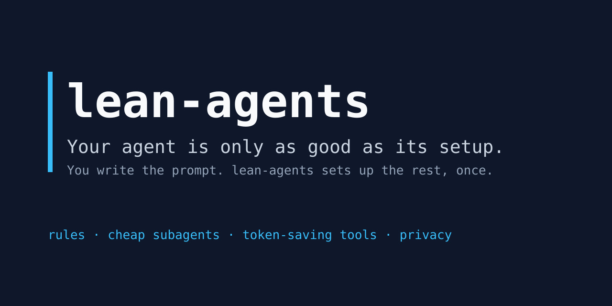
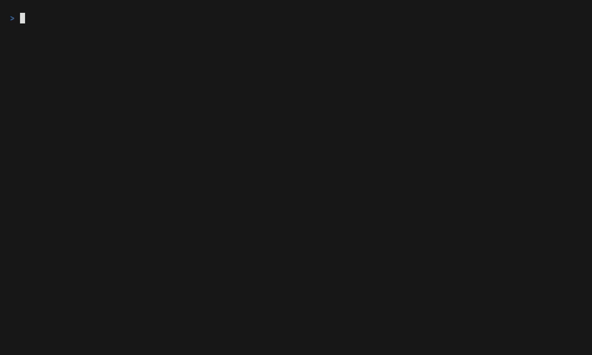

<div align="center">



# lean-agents

**Un comando. Todos tus agentes de código. Menos tokens, respuestas más claras.**

Las mismas reglas, subagentes baratos por defecto, herramientas que ahorran contexto y servidores MCP para Claude Code, OpenCode, GitHub Copilot CLI y Antigravity CLI, en macOS y Windows.

[Read in English](README.md)

</div>

> **Estado: versión preliminar v0.4.** El instalador funciona para **Claude Code**, **OpenCode 1.x y 2.x**, **GitHub Copilot CLI** y **Antigravity CLI** en macOS, Linux y Windows (Antigravity: macOS y Linux). Dale una estrella al repo para enterarte cuando salga `v1.0.0`.



## Inicio rápido

macOS, Linux o Git Bash:

```bash
curl -fsSL https://raw.githubusercontent.com/estebanmr99/lean-agents/main/install.sh | bash -s -- --dry-run
```

Windows PowerShell:

```powershell
& ([scriptblock]::Create((irm https://raw.githubusercontent.com/estebanmr99/lean-agents/main/install.ps1))) -DryRun
```

¿Prefieres que lo haga tu agente? Pega un prompt de [INSTALL_WITH_AGENT.md](INSTALL_WITH_AGENT.md) en Claude Code, OpenCode o Copilot CLI. Usa `--lang es` para que las reglas y las respuestas queden en español.

Empieza siempre con `--dry-run`: muestra cada archivo y comando antes de cambiar nada. En PowerShell las mismas opciones van en PascalCase: `-DryRun`, `-AllTools`, `-Privacy strict`, `-Profile vertex-gemini`.

Context Mode necesita Node.js 22.5 o superior. Todo lo demás funciona con Node.js 20.12.

## Por qué

- **Menos tokens.** Explorar, investigar y revisar lo hacen subagentes baratos. Las salidas grandes no entran al contexto. Los agentes buscan símbolos en vez de leer archivos completos.
- **Respuestas más claras.** Un solo set corto de reglas: primero la respuesta, supuestos explícitos, cambios quirúrgicos, verificar antes de decir que terminó.
- **Igual en todos lados.** Las reglas se escriben una vez en `core/` y se adaptan a cada agente.

## Qué incluye

| Función | Claude Code | OpenCode 2.x | OpenCode 1.x | Copilot CLI | Antigravity CLI |
| --- | --- | --- | --- | --- | --- |
| Reglas globales (AGENTS.md) | ✅ | ✅ | ✅ | ✅ | ⚠️ se escriben, carga sin probar |
| Subagentes por costo | ✅ | ✅ | ✅ | ✅ | ✅ flash, pro |
| RTK (comprime la salida del shell) | ✅ | ✅ | ✅ | ✅ | ✅ |
| Context Mode | ✅ plugin | ✅ MCP | ✅ plugin | ✅ plugin | ✅ plugin |
| Serena + Playwright MCP | ✅ | ✅ | ✅ | ✅ | ✅ |
| Ponytail | ✅ | ✅ | ✅ | ➖ | ➖ |
| i-have-adhd | ✅ | ✅ | ✅ | ✅ | ⚠️ se escribe, carga sin probar |
| Caveman y otras skills | ✅ | ✅ | ✅ | ✅ | ⚠️ se escriben, carga sin probar |
| Compactación de contexto | ✅ auto 80% | ✅ nativa | ✅ nativa, DCP opcional | ➖ | ➖ |
| Presets de red (telemetría, updates, salidas) | ✅ | ✅ updates, compartir | ✅ | ⚠️ updates; telemetría es un recordatorio | ⚠️ solo recordatorios |
| Proxy en cada comando de instalación | ✅ | ✅ | ✅ | ✅ | ⚠️ probado en CI, sin docs upstream |

✅ soportado · ⚠️ parcial · ➖ no disponible para este agente. Detalles y fechas de verificación: [docs/compatibility.md](docs/compatibility.md).

| Función | VS Code Copilot | Cursor (IDE y CLI) | Repo del equipo (`--project`) |
| --- | --- | --- | --- |
| Reglas | ⚠️ se escriben, carga sin probar | ➖ solo en ajustes, usa `--project` | ✅ `AGENTS.md` |
| Subagentes | ⚠️ se escriben, carga sin probar | ⚠️ se escriben, carga sin probar | ✅ `.github/agents`, `.cursor/agents` |
| RTK | ⚠️ solo a través de Copilot CLI | ✅ | ➖ por usuario |
| Context Mode, Serena, Playwright | ✅ MCP | ✅ MCP | ✅ `.vscode/mcp.json`, `.cursor/mcp.json` |
| Skills Caveman, i-have-adhd | ⚠️ se escriben, carga sin probar | ⚠️ se escriben, carga sin probar | ➖ por usuario |

**Próximamente: soporte completo de Antigravity.** Hoy lean-agents configura Antigravity CLI (`agy`) en macOS y Linux. Lo siguiente es la app de escritorio de Antigravity y la CLI en Windows. Según la documentación oficial, la app y la CLI leen las mismas reglas, subagentes, skills y servidores MCP, así que una sola configuración serviría para ambas en macOS, Windows y Linux. Cada parte sale solo cuando CI la prueba con binarios reales. Plan: [Session 11](docs/SPEC.md#session-11--antigravity-full-setup) (en inglés).

## VS Code Copilot y Cursor

lean-agents configura el chat de Copilot en VS Code y Cursor (el editor y su CLI `agent`) igual que los demás agentes:

- **VS Code Copilot:** reglas en `~/.copilot/copilot-instructions.md`, subagentes en `~/.copilot/agents/`, servidores MCP en tu `mcp.json` de usuario de VS Code, y skills. Copilot CLI lee los mismos archivos de `~/.copilot`, así que con los dos se escriben una sola vez.
- **Cursor:** subagentes en `~/.cursor/agents/`, servidores MCP en `~/.cursor/mcp.json`, el hook de RTK y skills. Cursor guarda las reglas de usuario en su pantalla de ajustes, no en un archivo, así que lean-agents no puede escribirlas. Usa el modo equipo de abajo para darle a Cursor las reglas a través del `AGENTS.md` del repo.

```bash
curl -fsSL https://raw.githubusercontent.com/estebanmr99/lean-agents/main/install.sh | bash -s -- --dry-run --agents vscode-copilot,cursor
```

```powershell
& ([scriptblock]::Create((irm https://raw.githubusercontent.com/estebanmr99/lean-agents/main/install.ps1))) -DryRun -Agents vscode-copilot,cursor
```

Quita `--dry-run` (`-DryRun`) para aplicar. `--uninstall` lo quita todo otra vez.

## Modo equipo (`--project`)

Pone la configuración compartida en un repositorio, así todo el equipo la recibe con `git pull`:

| Archivo | Qué hace |
| --- | --- |
| `AGENTS.md` | Las reglas, en un bloque marcado; tu propio texto se queda |
| `.github/copilot-instructions.md`, `.cursor/rules/lean-agents.mdc` | Una línea que apunta a `AGENTS.md`, para que las reglas se carguen una vez |
| `.github/agents/*.agent.md`, `.cursor/agents/*.md` | Subagentes por nivel para VS Code Copilot y Cursor |
| `.vscode/mcp.json`, `.cursor/mcp.json` | Context Mode, y Serena y Playwright si los eliges |

Ejecútalo desde la raíz del repositorio, revisa el plan, aplica y haz commit:

```bash
curl -fsSL https://raw.githubusercontent.com/estebanmr99/lean-agents/main/install.sh | bash -s -- --project . --dry-run --tools serena
curl -fsSL https://raw.githubusercontent.com/estebanmr99/lean-agents/main/install.sh | bash -s -- --project . --tools serena
git add AGENTS.md .github .vscode .cursor && git commit -m "chore: add lean-agents team setup"
```

En Windows: `& ([scriptblock]::Create((irm https://raw.githubusercontent.com/estebanmr99/lean-agents/main/install.ps1))) -Project . -DryRun`. Después, `--project . --update` vuelve a aplicar tus opciones guardadas y `--project . --uninstall` quita solo lo que añadió lean-agents. El modo equipo solo escribe archivos. Cada persona del equipo ejecuta el instalador una vez para las herramientas que mencionan las reglas (RTK, Context Mode y las demás), y su estado se guarda en su propia carpeta de usuario, nunca en el repo.

## Claude a través de GitHub Copilot

Si tu empresa paga GitHub Copilot, la forma oficial de usar Claude como agente es el **agente de código Claude**, un agente asociado de Copilot que activa un administrador. lean-agents no instala nada para esto, porque es un ajuste de políticas, no un paquete. Las herramientas que reutilizan un token de Copilot para ejecutar la CLI de Claude Code no son oficiales y no están soportadas. Pasos y ajustes de administración (en inglés): [docs/claude-with-copilot.md](docs/claude-with-copilot.md).

## Niveles de instalación

| Nivel | Qué incluye | Por defecto |
| --- | --- | --- |
| Mínimo | Reglas, subagentes por costo, compactación, límites de salida, RTK, Context Mode | Siempre |
| Herramientas opcionales | Serena, Playwright, Ponytail, Caveman, i-have-adhd, DCP (OpenCode 1.x, AGPL-3.0), Codeburn | Se pregunta una por una |
| Herramientas por elección | GSD Core, AutoSkills (CC BY-NC 4.0: solo uso no comercial) | Se pregunta una por una, nunca en `--all-tools` |
| Privacidad estricta | Sin telemetría, sin auto updates, sin compartir sesiones, sin proveedores que entrenan con tus prompts | Apagado, se activa con `--privacy strict` |
| Preset de red | Todo apagado (PC de trabajo), todo encendido, o por categoría: telemetría, auto updates, otras salidas | Todo encendido; `--network off` o una opción por categoría |
| GitHub CLI (`gh`) | Se instala con brew o winget sin admin; tú corres `gh auth login` | Se pregunta si falta; `--gh` |

## En una PC de trabajo: proxy, red y revisión de seguridad

1. **Revisa primero.** Pega el prompt de [docs/SECURITY-REVIEW.md](docs/SECURITY-REVIEW.md) en tu agente. Lista cada archivo, comando, host y herramienta, los compara con el código y te pide las páginas internas de TI o del proxy cuando no puede leerlas.
2. **Define tu proxy en tu propia terminal** antes de instalar, en mayúsculas o minúsculas:
   ```bash
   export HTTPS_PROXY=http://proxy.example:8080 NO_PROXY=localhost,127.0.0.1
   export NODE_EXTRA_CA_CERTS=/ruta/a/ca-empresa.pem   # si tu empresa inspecciona TLS
   ```
   El instalador pasa ambas formas a cada comando (brew y git leen minúsculas, uv mayúsculas) y las muestra en `--dry-run` y `--doctor` con la contraseña cambiada por `***`. Nunca las escribe en disco. Qué variable de CA lee cada herramienta: [docs/compatibility.md](docs/compatibility.md#proxy-and-corporate-ca).
3. **Elige un preset de red.** El instalador pregunta: **todo apagado** (PC de empresa), **todo encendido** (PC personal) o **por categoría**. Para correrlo sin preguntas:
   ```bash
   bash install.sh --dry-run --network off                    # todo apagado
   bash install.sh --yes --network off --auto-update on       # apagado, pero con auto updates
   ```
   Qué apaga cada categoría por agente: [docs/privacy.md](docs/privacy.md). La elección se guarda y `--update` la reutiliza.
4. **`gh`**: agrega `--gh` (o responde que sí) para instalar GitHub CLI sin admin; luego corre `gh auth login` tú mismo.

En una terminal real el instalador muestra menús (flechas, espacio para marcar), una lista de progreso y un resumen. Con `--yes`, con un pipe o sin terminal, hace preguntas simples o ninguna, como antes.

**Ajustes que el proyecto original no documenta** (telemetría y actualizaciones de Antigravity, la config de Serena, el proxy persistente de winget, los hosts de descarga, la telemetría de DCP, GSD y AutoSkills): lean-agents nunca los adivina. En una terminal real pregunta por cada uno: **pegar tu documentación o notas de TI** (una línea o la ruta a un archivo) o **dejar el valor por defecto de la herramienta**. Las notas se guardan, con cualquier contraseña de proxy oculta, en `~/.config/lean-agents/notes/<item>.md` y nunca se aplican solas: pídele a tu agente que las aplique y te muestre cada cambio antes. Si otro agente ya configuró la herramienta, no pregunta y no agrega notas. `--yes` siempre deja el valor por defecto.

## Modelos siempre al día

Los subagentes piden un nivel (`fast`, `balanced`, `strong`), no un modelo. En Claude Code eso son los alias `haiku`, `sonnet` y `opus`. Los demás agentes usan [perfiles](profiles/) fechados por suscripción, y la skill `update-models` los actualiza con tu aprobación.

## Seguridad

- Respalda cada archivo antes de tocarlo. `--uninstall` lo restaura.
- Nunca sobrescribe tu `AGENTS.md` ni tu `CLAUDE.md`: los importa o agrega un bloque marcado.
- Nunca pide, guarda ni muestra API keys.
- No necesita permisos de administrador (`--no-admin`).
- Se puede revisar antes de instalar: [docs/SECURITY-REVIEW.md](docs/SECURITY-REVIEW.md) es un prompt que tu agente corre sobre este repo.

## Créditos y licencia

Ver la sección de créditos en el [README en inglés](README.md#credits). Licencia [MIT](LICENSE).
