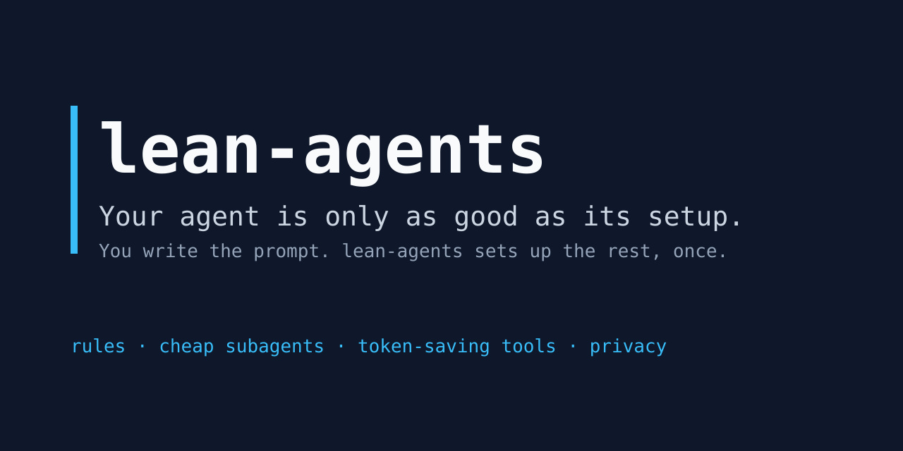
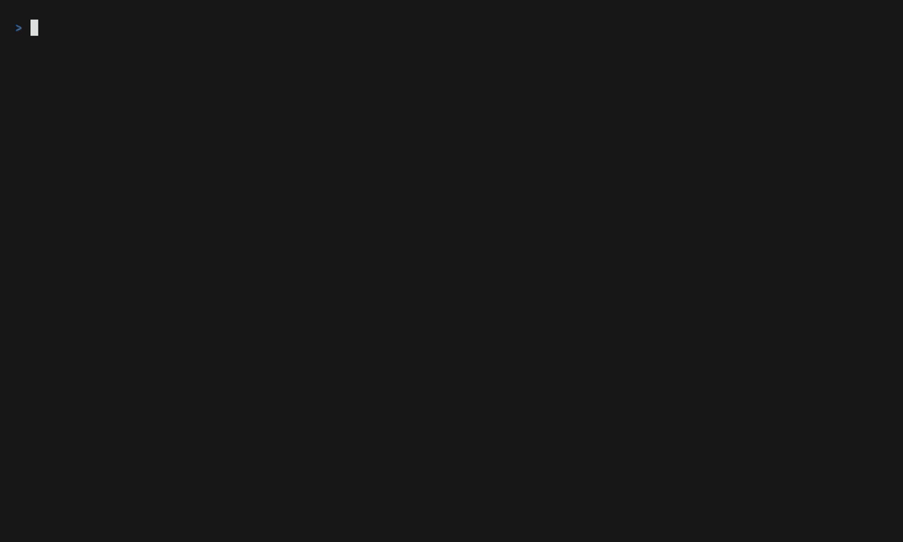

<div align="center">



# lean-agents

**One command. Every coding agent. Fewer tokens, clearer answers.**

The same rules, cheap-by-default subagents, context-saving tools and MCP servers for Claude Code, OpenCode 1.x and 2.x, GitHub Copilot CLI, Antigravity CLI, VS Code Copilot and Cursor, on macOS, Linux and Windows.

[](LICENSE)


[](https://github.com/estebanmr99/lean-agents/actions/workflows/ci.yml)
[](https://github.com/estebanmr99/lean-agents/actions/workflows/secret-scan.yml)


[Leer en español](README.es.md)

</div>

> **Status: v0.4 preview.** The installer works for **Claude Code**, **OpenCode 1.x and 2.x**, **GitHub Copilot CLI**, **Antigravity CLI**, **VS Code Copilot** and **Cursor** on macOS, Linux and Windows (Antigravity: macOS and Linux). Star the repo to get notified when `v1.0.0` ships.



## Quick start

macOS, Linux or Git Bash:

```bash
curl -fsSL https://raw.githubusercontent.com/estebanmr99/lean-agents/main/install.sh | bash -s -- --dry-run
```

Windows PowerShell:

```powershell
& ([scriptblock]::Create((irm https://raw.githubusercontent.com/estebanmr99/lean-agents/main/install.ps1))) -DryRun
```

Prefer your agent to do it? Paste a prompt from [INSTALL_WITH_AGENT.md](INSTALL_WITH_AGENT.md) into Claude Code, OpenCode or Copilot CLI. Use `--lang es` to get the rules and replies in Spanish.

Always start with `--dry-run`: it shows every file and command before anything changes. Then run it again without `--dry-run`; it asks which agents, tools, privacy level, language and model profile you want. Useful flags: `--all-tools`, `--privacy strict`, `--lang es`, `--profile vertex-gemini`, `--update`, `--uninstall`, `--doctor` (`--help` lists them all). In PowerShell the common flags are PascalCase: `-DryRun`, `-AllTools`, `-Privacy strict`, `-Profile vertex-gemini`. Any other flag is passed as it is, for example `-DryRun --network off`.

Context Mode needs Node.js 22.5 or newer. Everything else works on Node.js 20.12.

## Demo: OpenCode with GitHub Copilot models

1. Install OpenCode (macOS, Linux or Git Bash). On Windows, see the [OpenCode docs](https://opencode.ai/docs):
   ```bash
   curl -fsSL https://opencode.ai/v2/install | bash
   ```
2. Preview what lean-agents would change:
   ```bash
   curl -fsSL https://raw.githubusercontent.com/estebanmr99/lean-agents/main/install.sh | bash -s -- --agents opencode-v2 --profile github-copilot --dry-run
   ```
   ```powershell
   & ([scriptblock]::Create((irm https://raw.githubusercontent.com/estebanmr99/lean-agents/main/install.ps1))) -Agents opencode-v2 -Profile github-copilot -DryRun
   ```
3. Run the same without the dry run:
   ```bash
   curl -fsSL https://raw.githubusercontent.com/estebanmr99/lean-agents/main/install.sh | bash -s -- --agents opencode-v2 --profile github-copilot
   ```
   ```powershell
   & ([scriptblock]::Create((irm https://raw.githubusercontent.com/estebanmr99/lean-agents/main/install.ps1))) -Agents opencode-v2 -Profile github-copilot
   ```
4. Start `opencode`, run `/connect`, pick GitHub Copilot and sign in with your GitHub account (it needs a Copilot plan). lean-agents never handles the login. Subagents use the `github-copilot` profile: `fast` = claude-haiku-5.5, `balanced` = claude-sonnet-5.5, `strong` = claude-opus-5.5. No free OpenCode models are used.
5. Check the result:
   ```bash
   curl -fsSL https://raw.githubusercontent.com/estebanmr99/lean-agents/main/install.sh | bash -s -- --doctor
   ```

Claude Desktop and Cursor demo paths come later.

## Why

- **Fewer tokens.** Exploration, research and review go to cheap subagents. Big outputs stay out of the context window. Agents search symbols instead of reading whole files.
- **Clearer answers.** One short set of global rules: answer first, state assumptions, surgical changes, verify before saying done.
- **Same behavior everywhere.** Rules are written once in `core/` and rendered for each agent.

## What you get

| Feature | Claude Code | OpenCode 2.x | OpenCode 1.x | Copilot CLI | Antigravity CLI |
| --- | --- | --- | --- | --- | --- |
| Global rules (AGENTS.md) | ✅ | ✅ | ✅ | ✅ | ⚠️ written, load unproven |
| Subagents by cost tier | ✅ | ✅ | ✅ | ✅ | ✅ flash, pro |
| RTK (shell output compression) | ✅ | ✅ | ✅ | ✅ | ✅ |
| Context Mode | ✅ plugin | ✅ MCP | ✅ plugin | ✅ plugin | ✅ plugin |
| Serena + Playwright MCP | ✅ | ✅ | ✅ | ✅ | ✅ |
| Signed-in browser (opt-in) | ➖ Claude in Chrome | ✅ opt-in | ✅ opt-in | ✅ opt-in | ➖ |
| Ponytail | ✅ | ✅ | ✅ | ➖ | ➖ |
| i-have-adhd | ✅ | ✅ | ✅ | ✅ | ⚠️ written, load unproven |
| Caveman and other skills | ✅ | ✅ | ✅ | ✅ | ⚠️ written, load unproven |
| Context compaction | ✅ auto 80% | ✅ native | ✅ native, optional DCP | ➖ | ➖ |
| Network presets (telemetry, updates, outbound) | ✅ | ✅ updates, sharing | ✅ | ⚠️ updates; telemetry is a reminder | ⚠️ reminders only |
| Proxy passed to every install command | ✅ | ✅ | ✅ | ✅ | ⚠️ checked in CI, undocumented upstream |

✅ supported · ⚠️ partial · ➖ not available for this agent. Details and verification dates: [docs/compatibility.md](docs/compatibility.md).

| Feature | VS Code Copilot | Cursor (IDE and CLI) | Team repo (`--project`) |
| --- | --- | --- | --- |
| Rules | ⚠️ written, load unproven | ➖ settings UI only, use `--project` | ✅ `AGENTS.md` |
| Subagents | ⚠️ written, load unproven | ⚠️ written, load unproven | ✅ `.github/agents`; ⚠️ `.cursor/agents` (Cursor CLI loading unverified) |
| RTK | ⚠️ through Copilot CLI only | ✅ | ➖ per user |
| Context Mode, Serena, Playwright | ✅ MCP | ✅ MCP | ✅ `.vscode/mcp.json`, `.cursor/mcp.json` |
| Signed-in browser (opt-in) | ✅ opt-in | ✅ opt-in | ➖ per user |
| Caveman, i-have-adhd skills | ⚠️ written, load unproven | ⚠️ written, load unproven | ➖ per user |

**Planned: full Antigravity support.** Today lean-agents sets up the Antigravity CLI (`agy`) on macOS and Linux. Next it adds the Antigravity desktop app and the CLI on Windows. The upstream docs say the app and the CLI read the same rules, subagents, skills and MCP servers, so one setup would serve both on macOS, Windows and Linux. Each part ships only once CI proves it with real binaries. Plan: [Session 11](docs/SPEC.md#session-11--antigravity-full-setup).

## Signed-in browser (opt-in)

The default `playwright` MCP opens a fresh headless browser, which fails on pages behind single sign-on. `--tools playwright-extension` adds `@playwright/mcp --extension` instead. It attaches to your own signed-in Chrome or Edge through the [Playwright Extension](https://chromewebstore.google.com/detail/playwright-extension/mmlmfjhmonkocbjadbfplnigmagldckm).

- Install the extension yourself. Extensions cannot be installed silently without an admin policy.
- Each session asks you to approve the connection. Auto-approve with a token is optional: see [docs/browser-extension.md](docs/browser-extension.md). The installer never asks for, stores or prints the token.
- Works with OpenCode, Copilot CLI, VS Code Copilot and Cursor. Claude Code and Claude Desktop use Claude in Chrome instead.

## VS Code Copilot and Cursor

lean-agents sets up the Copilot chat in VS Code and Cursor (the editor and its `agent` CLI) like the other agents:

- **VS Code Copilot:** rules in `~/.copilot/copilot-instructions.md`, subagents in `~/.copilot/agents/`, MCP servers in your VS Code user `mcp.json`, and skills. Copilot CLI reads the same `~/.copilot` files, so with both they are written once.
- **Cursor:** subagents in `~/.cursor/agents/`, MCP servers in `~/.cursor/mcp.json`, the RTK hook and skills. Cursor keeps user rules in its settings screen, not in a file, so lean-agents cannot write them. Use team mode below to give Cursor the rules through the repo's `AGENTS.md`.

```bash
curl -fsSL https://raw.githubusercontent.com/estebanmr99/lean-agents/main/install.sh | bash -s -- --dry-run --agents vscode-copilot,cursor
```

```powershell
& ([scriptblock]::Create((irm https://raw.githubusercontent.com/estebanmr99/lean-agents/main/install.ps1))) -DryRun -Agents vscode-copilot,cursor
```

Drop `--dry-run` (`-DryRun`) to apply. `--uninstall` removes it all again.

## Team mode (`--project`)

Puts the shared setup into one repository, so everyone on the team gets it with `git pull`:

| File | What it does |
| --- | --- |
| `AGENTS.md` | The rules, in a marked block; your own text stays |
| `.github/copilot-instructions.md`, `.cursor/rules/lean-agents.mdc` | One line pointing to `AGENTS.md`, so rules load once |
| `.github/agents/*.agent.md`, `.cursor/agents/*.md` | Tiered subagents for VS Code Copilot and Cursor |
| `.vscode/mcp.json`, `.cursor/mcp.json` | Context Mode, plus Serena and Playwright if you pick them |

Run it from the repository root, check the plan, apply, and commit:

```bash
curl -fsSL https://raw.githubusercontent.com/estebanmr99/lean-agents/main/install.sh | bash -s -- --project . --dry-run --tools serena
curl -fsSL https://raw.githubusercontent.com/estebanmr99/lean-agents/main/install.sh | bash -s -- --project . --tools serena
git add AGENTS.md .github .vscode .cursor && git commit -m "chore: add lean-agents team setup"
```

On Windows: `& ([scriptblock]::Create((irm https://raw.githubusercontent.com/estebanmr99/lean-agents/main/install.ps1))) -Project . -DryRun`. Later, `--project . --update` re-applies your saved choices, and `--project . --uninstall` removes only what lean-agents added. Team mode writes files only. Each teammate still runs the installer once for the tools the rules mention (RTK, Context Mode and the rest), and their state stays in their own home folder, never in the repo.

## Claude through GitHub Copilot

If your company pays for GitHub Copilot, the official way to use Claude as an agent is the **Claude coding agent**, a Copilot partner agent that an admin turns on. lean-agents installs nothing for it, because it is a policy switch, not a package. Tools that reuse a Copilot token to run the Claude Code CLI are not official and not supported. Steps and admin settings: [docs/claude-with-copilot.md](docs/claude-with-copilot.md).

## Install tiers

| Tier | What | Default |
| --- | --- | --- |
| Minimal | Rules, tiered subagents, compaction, output limits, RTK, Context Mode | Always |
| Optional tools | Serena, Playwright, Ponytail, Caveman, i-have-adhd, DCP (OpenCode 1.x, AGPL-3.0), Codeburn | Asked one by one |
| Opt-in tools | GSD Core, AutoSkills (CC BY-NC 4.0: non-commercial use only) | Asked one by one, never in `--all-tools` |
| Strict privacy | No telemetry, no auto-updates, no session sharing, no providers that train on your prompts | Off, opt in with `--privacy strict` |
| Network preset | All off (work PC), all on, or per category: telemetry, auto-updates, other outbound calls | All on; `--network off` (same as `--privacy strict`) or `--telemetry`, `--auto-update`, `--outbound` |
| GitHub CLI (`gh`) | Installed with brew or winget at user scope; you run `gh auth login` | Asked when missing; `--gh` |

## On a work PC: proxy, network and security review

1. **Review first.** Paste the prompt from [docs/SECURITY-REVIEW.md](docs/SECURITY-REVIEW.md) into your agent. It lists every file, command, host and tool, checks them against the code, and asks for your company's IT or proxy pages when it cannot read them itself.
2. **Set your proxy in your own shell** before you run the installer, in either letter case:
   ```bash
   export HTTPS_PROXY=http://proxy.example:8080 NO_PROXY=localhost,127.0.0.1
   export NODE_EXTRA_CA_CERTS=/path/to/company-ca.pem   # if your company inspects TLS
   ```
   The installer passes both cases to every command it runs (brew and git read lowercase, uv uppercase) and shows them in `--dry-run` and `--doctor` with any password replaced by `***`. It never writes them to disk. Which CA variable each tool reads: [docs/compatibility.md](docs/compatibility.md#proxy-and-corporate-ca).
3. **Pick a network preset.** The installer asks: **all off** (enterprise PC), **all on** (personal PC) or **per category**. For scripted runs:
   ```bash
   curl -fsSL https://raw.githubusercontent.com/estebanmr99/lean-agents/main/install.sh | bash -s -- --dry-run --network off                # everything off
   curl -fsSL https://raw.githubusercontent.com/estebanmr99/lean-agents/main/install.sh | bash -s -- --yes --network off --auto-update on   # off, but keep auto-updates
   ```
   The per-category flags are `--telemetry on|off`, `--auto-update on|off` and `--outbound on|off`. `--network off` is the same as `--privacy strict`. In PowerShell they pass as they are, for example `-DryRun --network off`. What each category turns off per agent: [docs/privacy.md](docs/privacy.md). The choice is saved and reused by `--update`.
4. **`gh`**: add `--gh` (or answer yes) to install GitHub CLI without admin rights, then run `gh auth login` yourself.

In a real terminal the installer shows menus (arrow keys, space to toggle), a progress list and a summary. With `--yes`, a pipe or no terminal, it asks plain questions or none, as before.

**Settings upstream does not document** (Antigravity telemetry and auto-updates, Serena's config, winget's persistent proxy, download hosts, DCP, GSD and AutoSkills telemetry): lean-agents never guesses them. In a real terminal it asks per item: **paste your docs or IT notes** (one line, or a path to a file) or **keep the tool's default**. Notes are saved, with any proxy password hidden, to `~/.config/lean-agents/notes/<item>.md` and never applied automatically: ask your agent to apply them and show you each change first. If another agent already set the tool up, the question is skipped and lean-agents adds no notes for it. `--yes` always keeps the default.

## Models that stay current

Subagents ask for a tier (`fast`, `balanced`, `strong`), not a model ID. Claude Code maps tiers to the `haiku`, `sonnet` and `opus` aliases, which always point to the newest models. Other agents use dated [profiles](profiles/) per subscription, and the `update-models` skill refreshes them with your approval.

## Safety

- Backs up every file before touching it. `--uninstall` restores them.
- Never overwrites your `AGENTS.md` or `CLAUDE.md`: it imports or appends a marked block.
- Never asks for, stores or prints API keys. You log in to providers yourself.
- No admin rights needed (`--no-admin`), so it works on locked-down work laptops.
- Reviewable before install: [docs/SECURITY-REVIEW.md](docs/SECURITY-REVIEW.md) is a prompt your agent runs on this repo.

## Credits

lean-agents is glue. The heavy lifting is done by these projects; please star them too:

[RTK](https://github.com/rtk-ai/rtk) ·
[Context Mode](https://github.com/mksglu/context-mode) ·
[Serena](https://github.com/oraios/serena) ·
[Playwright MCP](https://github.com/microsoft/playwright-mcp) ·
[Ponytail](https://github.com/DietrichGebert/ponytail) ·
[Caveman](https://github.com/juliusbrussee/caveman) ·
[i-have-adhd](https://github.com/ayghri/i-have-adhd) ·
[OpenCode DCP](https://github.com/Opencode-DCP/opencode-dynamic-context-pruning) ·
[GSD Core](https://github.com/open-gsd/gsd-core) ·
[andrej-karpathy-skills](https://github.com/multica-ai/andrej-karpathy-skills) ·
[Codeburn](https://github.com/getagentseal/codeburn) · [AutoSkills](https://github.com/midudev/autoskills) · [Skills CLI](https://vercel.com/changelog/introducing-skills-the-open-agent-skills-ecosystem)

## Roadmap

- [x] Spec, rules and subagent definitions
- [x] Installer for Claude Code and OpenCode 2.x (macOS, Linux)
- [x] Windows installer and OpenCode 1.x
- [x] Copilot CLI, Antigravity CLI, Codeburn, AutoSkills, GSD, original skills, model profiles
- [x] VS Code Copilot, Cursor, team mode (`--project`), Claude through Copilot
- [ ] Planned: terminals (Warp, Orca), parallel agent sessions, full Antigravity setup (app, and the CLI on Windows)
- [ ] `v1.0.0`
- Later: Codex CLI, Gemini CLI

## Contributing

Issues and PRs are welcome. Read [CONTRIBUTING.md](CONTRIBUTING.md) first; every PR runs a secret and privacy scan.

## License

[MIT](LICENSE)
