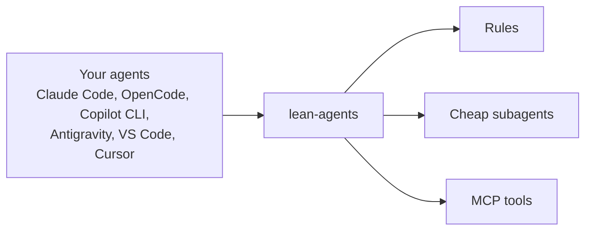

<div align="center">


# lean-agents

**Your agent is only as good as its setup. lean-agents does the setup.**

[](https://www.npmjs.com/package/lean-agents) [](LICENSE) [](https://github.com/estebanmr99/lean-agents/actions/workflows/ci.yml) [](https://github.com/estebanmr99/lean-agents/actions/workflows/secret-scan.yml) 

[Leer en español](README.es.md)

</div>

What your agent writes is only as good as what you give it: your prompt, and the setup around it. Rules. Cheap subagents for the boring work. Tools that save tokens. Privacy you chose.

You should not have to perfect every prompt. lean-agents sets the rest up for you, once, on top of the agents you already use.

### Paste this into your agent

It asks you each choice, shows a dry run, and waits for your OK.

```text
Install lean-agents for me from https://github.com/estebanmr99/lean-agents.
Follow docs/install-with-an-agent.md in that repo. Ask before every change.
Never read, print or store my API keys or tokens, and never run gh auth login for me.
```

### Or run it yourself

Needs Node.js 22.20+ and git. `--dry-run` lists every file and command; nothing changes:

```bash
npx lean-agents@latest --dry-run
```

PowerShell takes the same command. No Node.js yet? See [Fallback: bootstraps](#fallback-bootstraps). Flags and pinning: [Quick start](#quick-start).

### What's new

Read the [latest release notes](https://github.com/estebanmr99/lean-agents/releases/latest) and the [CHANGELOG](CHANGELOG.md). Already installed? Paste this to update; it also takes over an install you made by hand:

```text
Update lean-agents for me from https://github.com/estebanmr99/lean-agents.
Use the lean-update skill, or follow docs/install-with-an-agent.md "Update with an agent". Show me a table first and ask before every change.
Never read, print or store my API keys or tokens.
```

<div align="center">


</div>

## Supported agents

| Agent | macOS | Linux | Windows | Rules | Subagents | MCP tools | Real-binary CI job |
| --- | --- | --- | --- | --- | --- | --- | --- |
| Claude Code | VERIFY | ✅ | VERIFY | ✅ | ✅ | ✅ | `real-claude` |
| OpenCode 1.x | VERIFY | ✅ | ✅ | ✅ | ✅ | ✅ | `real-opencode-v1`, `real-windows`, `real-opencode-shell` |
| OpenCode 2.x | VERIFY | ✅ | VERIFY | ✅ | ✅ | ✅ | `real-opencode`, `real-opencode-shell` |
| Copilot CLI | ✅ | ✅ | ✅ | ✅ | ✅ | ✅ | `real-copilot`, `real-copilot-windows` |
| Antigravity CLI | ✅ | ✅ | ✅ | ⚠️ | ✅ | ✅ | `real-antigravity`, `real-antigravity-windows` |
| VS Code Copilot | ✅ | ✅ | VERIFY | ⚠️ | ⚠️ | ✅ | `real-vscode` |
| Cursor | VERIFY | ✅ | ✅ | ➖ (`--project` only) | ⚠️ | ✅ | `real-cursor`, `real-cursor-windows` |

On Windows, agents work best with Git Bash installed (RTK and bash-style commands need it); the install summary and `--doctor` tell you which shell is found and what to do if not. For OpenCode, lean-agents also sets its `shell` key to Git Bash when found, so the bash tool runs there by default (`--shell default` opts out; a `shell` you already set is kept).

✅ a CI job runs the real binary on that OS (OS columns) or lean-agents writes it (feature columns) · ⚠️ written, load unproven · ➖ not available · VERIFY not proven yet. Per-agent files and verification dates: [docs/compatibility.md](docs/compatibility.md).

**Who it's for:** solo developers · teams (`--project` writes the setup into the repo) · work PCs behind a proxy ([details](#on-a-work-pc-proxy-network-and-security-review)).

<!-- details -->
## Details

lean-agents works with Claude Code, OpenCode 1.x and 2.x, GitHub Copilot CLI, Antigravity CLI, VS Code Copilot and Cursor on macOS, Linux and Windows. Star the repo to get notified when `v1.0.0` ships.

**Contents**

- [Demo: OpenCode with GitHub Copilot models](#demo-opencode-with-github-copilot-models)
- [Quick start](#quick-start)
- [Why](#why) · [What you get](#what-you-get)
- [Warp and Orca](#warp-and-orca) · [Signed-in browser](#signed-in-browser-opt-in) · [VS Code Copilot and Cursor](#vs-code-copilot-and-cursor)
- [Team mode](#team-mode---project) · [Migrate](#migrate-from-another-tool---migrate) · [Parallel agent sessions](#parallel-agent-sessions) · [Claude through GitHub Copilot](#claude-through-github-copilot)
- [Install tiers](#install-tiers) · [On a work PC](#on-a-work-pc-proxy-network-and-security-review) · [Models that stay current](#models-that-stay-current)
- [Safety](#safety) · [Credits](#credits) · [Roadmap](#roadmap) · [Contributing](#contributing) · [License](#license)

## At a glance

- **Rules:** one short global rule set, rendered for each agent.
- **Cheap subagents:** exploration, research and review run on the cheapest fitting model tier.
- **Context-saving tools:** RTK, Context Mode, Serena and Playwright MCP.
- **Privacy presets:** `--privacy strict` or `off` for telemetry, updates and outbound calls.



## Demo: OpenCode with GitHub Copilot models

1. Install OpenCode. macOS, Linux or Git Bash:
   ```bash
   curl -fsSL https://opencode.ai/v2/install | bash
   ```
   Windows PowerShell (the upstream script runs through Git Bash and only edits `~/.bashrc`, so this adds the folder to your user PATH; open a new terminal afterwards):
   ```powershell
   curl.exe -fsSL https://opencode.ai/v2/install -o "$env:TEMP\opencode-install.sh"
   & "$env:ProgramFiles\Git\bin\bash.exe" -l (($env:TEMP -replace '\\','/') + '/opencode-install.sh') --no-modify-path
   $bin = "$HOME\.opencode\bin"; $u = [Environment]::GetEnvironmentVariable('Path','User')
   if (($u -split ';') -notcontains $bin) { [Environment]::SetEnvironmentVariable('Path', "$u;$bin", 'User') }
   opencode --version
   ```
2. Preview what lean-agents would change (`--yes` takes the defaults, so the preview asks nothing). macOS, Linux or Git Bash:
   ```bash
   curl -fsSL https://github.com/estebanmr99/lean-agents/releases/latest/download/install.sh | bash -s -- --agents opencode-v2 --profile github-copilot --dry-run --yes
   ```
   Windows PowerShell:
   ```powershell
   & ([scriptblock]::Create((irm https://github.com/estebanmr99/lean-agents/releases/latest/download/install.ps1))) -Agents opencode-v2 -Profile github-copilot -DryRun -Yes
   ```
3. Run the same without the dry run; in a terminal it asks you the questions you skipped with `--yes`. macOS, Linux or Git Bash:
   ```bash
   curl -fsSL https://github.com/estebanmr99/lean-agents/releases/latest/download/install.sh | bash -s -- --agents opencode-v2 --profile github-copilot
   ```
   Windows PowerShell:
   ```powershell
   & ([scriptblock]::Create((irm https://github.com/estebanmr99/lean-agents/releases/latest/download/install.ps1))) -Agents opencode-v2 -Profile github-copilot
   ```
4. Start `opencode`, run `/connect`, pick GitHub Copilot and sign in with your GitHub account (it needs a Copilot plan). lean-agents never handles the login.
   - Subagents use the `github-copilot` profile: `fast` = claude-haiku-5.5, `balanced` = claude-sonnet-5.5, `strong` = claude-opus-5.5.
   - No free OpenCode models are used.
5. Check the result:
   ```bash
   npx lean-agents@latest --doctor
   ```

Claude Desktop and Cursor demo paths come later.

## Quick start

Needs Node.js 22.20+ and git (Context Mode 2 and GSD Core need Node.js 24, see the Node.js 24 bullet below). The commands run the latest release from [npm](https://www.npmjs.com/package/lean-agents):

```bash
npx lean-agents@latest --dry-run     # every file and command; changes nothing
npx lean-agents@latest               # the real install, after your OK
npx lean-agents@latest --doctor      # check the install
npx lean-agents@latest --update      # re-apply with your saved choices
npx lean-agents@latest --uninstall   # undo everything lean-agents changed
```

The agent prompts have [a guide](docs/install-with-an-agent.md) with the steps and `--json` output; [the update steps](docs/install-with-an-agent.md#update-with-an-agent) work without the `lean-update` skill too.

Use `--lang es` to get the rules and replies in Spanish.

Always start with `--dry-run`: it shows every file and command before anything changes. Then run it again without `--dry-run`; it asks which agents, tools, privacy level, language and model profile you want.

- Useful flags: `--all-tools`, `--privacy strict`, `--lang es`, `--profile vertex-gemini`, `--update`, `--uninstall`, `--doctor`, `--json` (with `--dry-run`, `--doctor` or `--adopt`, for agents) (`--help` lists them all).
- `--adopt`: lists what a hand-built machine already has (MCP servers, Claude hooks and plugins, OpenCode plugins, skills, npm copies under each nvm Node, OpenCode session count), marks each one managed, user, stale, duplicate, drift or wrong-node, and prints the planned action. Alone it changes nothing; env and header values are never read. `--adopt --yes` applies the plan: it backs up every file it edits to `~/.config/lean-agents/adopt-<time>/` (owner-only), re-registers managed MCPs as `<tool Node> <entry>`, checks that each one answers `initialize` and that your own files and the OpenCode session count are unchanged, runs `--doctor`, and undoes itself if anything fails. Removing an old npm copy, a duplicate skill folder or a hand-made stopgap needs a yes (a menu on a terminal, `--confirm-removals` without one); otherwise they are listed and kept. `--keep-backup` keeps the backup after a good run; `--adopt --undo` restores every edited file byte for byte from it.
- `--upgrade-agent opencode`: dry run for moving OpenCode 1.x to 2.x. Sorts your 1.x config into managed (lean-agents reinstalls it), translatable (a verified 1.x key has a 2.x key: `agent` to `agents`, `mcp` to `mcp.servers`, `compaction.reserved` to `compaction.buffer`, ...) and manual (no proven 2.x equivalent, with the reason); prints the translation table; changes nothing (`--json` for one JSON object). Apply and `--undo` are not in this release yet. The opt-in `lean-migrate` skill (`--tools lean-migrate`) walks an agent through it.
- `--install-agent a,b` / `--uninstall-agent a,b` (opt-in): install an agent CLI (`claude`, `opencode-v2`, `copilot-cli`, `cursor`, `antigravity`) from its pinned installer (SHA256-checked before it runs; Linux and macOS, plus Copilot CLI on Windows) or remove it again. It shows the plan first (`--dry-run` stops there; `--yes` skips the question). Install records the files the installer created with their SHA256; uninstall deletes only those that still match, or runs `npm uninstall -g`, never the agent's own uninstaller, and leaves your config and data alone. An agent you installed yourself is reported as "not installed by lean-agents" and left alone. OpenCode 1.x is never installed or removed.
- In PowerShell the common flags are PascalCase: `-DryRun`, `-AllTools`, `-Privacy strict`, `-Profile vertex-gemini`. Any other flag is passed as it is, for example `-DryRun --network off`.
- Context Mode 2 needs Node.js 24.15 and GSD Core needs Node.js 24 (`engines.node` in `core/pins.json`). On an older active Node, lean-agents runs them on an nvm Node 24 without changing your default (nvm-windows: one already installed) and registers it with its absolute path; on Claude Code that means an MCP server instead of the Context Mode plugin, so its hooks and skills are not installed. Without nvm it skips them with one line. Everything else works on Node.js 22.20 or newer.
- With Context Mode, the installer also sets up Bun by default (faster `ctx_execute`); add `--no-bun` (`-NoBun` in PowerShell) to skip it. With Antigravity, `--no-app` (`-NoApp`) skips installing the app. See the Bun row in [Install tiers](#install-tiers).

### All flags

Every flag from `--help`. In PowerShell the same flags are PascalCase (`-DryRun`).

| Flag | What it does |
| --- | --- |
| `--dry-run` | Show every file change and command; change nothing |
| `--yes` | Accept defaults without asking |
| `--agents a,b` | Agents to set up: claude, opencode-v1, opencode-v2, copilot-cli, antigravity, vscode-copilot, cursor (default: the ones installed) |
| `--tools a,b` | Optional tools on top of RTK and Context Mode: serena, playwright, ponytail, caveman, i-have-adhd, dcp, codeburn, copilot-usage, gsd, autoskills, playwright-extension, coordinate, lean-migrate |
| `--all-tools` | Every optional tool except gsd, autoskills, playwright-extension, coordinate and lean-migrate |
| `--no-tools` | No optional tools |
| `--no-core` | Leave out RTK and Context Mode; install only the `--tools` you list |
| `--privacy` standard or strict | Same as `--network on` (standard) or `--network off` (strict) |
| `--network` on or off | Preset for telemetry, auto-updates and other outbound calls |
| `--telemetry`, `--auto-update`, `--outbound` on or off | One category; overrides the preset |
| `--profile <name>` | Model profile for OpenCode |
| `--lang` en or es | Language for rules and replies |
| `--terminal` warp, orca, both or none | Agent integrations for a terminal you already have (default: the detected ones) |
| `--gh` / `--no-gh` | Install GitHub CLI (`gh`) if it is missing (default: on) |
| `--bun` / `--no-bun` | Install Bun for Context Mode (default: on) |
| `--no-app` | Do not install the Antigravity app (the CLI is still installed when missing) |
| `--project <dir>` | Write the shared team files into one repository |
| `--migrate <from>` or `auto` | Copy rules, agents, skills, prompts and MCP servers from another harness; never overwrites |
| `--adhd-always` | Turn on i-have-adhd for every answer |
| `--ponytail-mode` lite, full, ultra or off | Ponytail level |
| `--shell` default or git-bash | OpenCode on Windows: use Git Bash when found (default: git-bash); never overwrites a shell you set yourself |
| `--json` | With `--dry-run`, `--doctor` or `--adopt`: print one JSON object on stdout |
| `--feedback-draft` | After a failed install: read the error on stdin and print a redacted issue draft as JSON. Needs `--failed-command` |
| `--failed-command <text>` | The command that failed, for `--feedback-draft` |
| `--feedback-kind update` | With `--feedback-draft`: the text is a finding from an update, not an error |
| `--update` | Re-apply with your saved choices |
| `--doctor` | Check the install |
| `--uninstall` | Undo everything lean-agents changed |
| `--adopt` | List what a hand-built machine already has and what each item is; with `--yes` it applies the plan |
| `--confirm-removals` | With `--adopt --yes` and no terminal: also remove old npm copies, duplicate skill folders and hand-made stopgaps (all backed up) |
| `--keep-backup` | Keep the backup after a verified `--adopt --yes` |
| `--undo` | With `--adopt`: restore what the last `--adopt --yes` changed |
| `--upgrade-agent opencode` | Dry run for moving OpenCode 1.x to 2.x; changes nothing |
| `--install-agent a,b` / `--uninstall-agent a,b` | Install or remove agent CLIs that lean-agents installed; plan first, `--yes` runs it; never OpenCode 1.x |
| `--usage` | Print the Copilot credits left (one `gh` call, no model request) |
| `--version` | Print the lean-agents version |
| `--home <dir>` | Treat this folder as your home directory; use a temp folder to try things safely |

### Fallback: bootstraps

Use these only when you have no Node.js 22.20+ yet. They check for git and Node.js 22.20+. If one is missing, `install.sh` offers `brew install` only when Homebrew is installed (it asks first); otherwise it stops with a download link. `install.ps1` does the same with `winget` (it asks first unless you pass `-Yes`). Then they download the latest release, check it against the release's `SHA256SUMS`, and only then run it.

```bash
curl -fsSL https://github.com/estebanmr99/lean-agents/releases/latest/download/install.sh | bash -s -- --dry-run
```

```powershell
& ([scriptblock]::Create((irm https://github.com/estebanmr99/lean-agents/releases/latest/download/install.ps1))) -DryRun
```

`LEAN_AGENTS_VERSION=0.8.0` pins a release. Once installed, `--dry-run`, `--doctor` and `--uninstall` need no network. A local checkout (`bash install.sh` from a clone) is trusted as it is; only the release download is checksum-verified.

## Why

- **Fewer tokens.** Exploration, research and review go to cheap subagents. Big outputs stay out of the context window. Agents search symbols instead of reading whole files.
- **Clearer answers.** One short set of global rules: answer first, state assumptions, surgical changes, verify before saying done.
- **Same behavior everywhere.** Rules are written once in `core/` and rendered for each agent.

## What you get

| Feature | Claude Code | OpenCode 2.x | OpenCode 1.x | Copilot CLI | Antigravity CLI |
| --- | --- | --- | --- | --- | --- |
| Global rules (AGENTS.md) | ✅ | ✅ | ✅ | ✅ | ⚠️ written, load unproven |
| Subagents by cost tier | ✅ | ✅ | ✅ | ✅ | ✅ flash, pro |
| RTK (shell output compression) | ✅ | ✅ | ✅ | ✅ | ✅ |
| Context Mode | ✅ plugin | ✅ MCP | ✅ plugin | ✅ MCP | ➖ skipped (no v2 setup) |
| Serena + Playwright MCP | ✅ | ✅ | ✅ | ✅ | ✅ |
| Signed-in browser (opt-in) | ➖ Claude in Chrome | ✅ opt-in | ✅ opt-in | ✅ opt-in | ➖ |
| Ponytail | ✅ | ✅ | ✅ | ➖ | ➖ |
| i-have-adhd | ✅ | ✅ | ✅ | ✅ | ⚠️ written, load unproven |
| Caveman and other skills | ✅ | ✅ | ✅ | ✅ | ⚠️ written, load unproven |
| Context compaction | ✅ auto 80% | ✅ native | ✅ native, optional DCP | ➖ | ➖ |
| Network presets (telemetry, updates, outbound) | ✅ | ✅ updates, sharing | ✅ | ⚠️ updates; telemetry is a reminder | ⚠️ reminders only |
| Proxy passed to every install command | ✅ | ✅ | ✅ | ✅ | ⚠️ checked in CI, undocumented upstream |

✅ supported · ⚠️ partial · ➖ not available for this agent. Details and verification dates: [docs/compatibility.md](docs/compatibility.md).

| Feature | VS Code Copilot | Cursor (IDE and CLI) | Team repo (`--project`) |
| --- | --- | --- | --- |
| Rules | ⚠️ written, load unproven | ➖ settings UI only, use `--project` | ✅ `AGENTS.md` |
| Subagents | ⚠️ written, load unproven | ⚠️ written, load unproven | ✅ `.github/agents`; ⚠️ `.cursor/agents` (Cursor CLI loading unverified) |
| RTK | ⚠️ through Copilot CLI only | ✅ | ➖ per user |
| Context Mode, Serena, Playwright | ✅ MCP | ✅ MCP | ✅ `.vscode/mcp.json`, `.cursor/mcp.json` |
| Signed-in browser (opt-in) | ✅ opt-in | ✅ opt-in | ➖ per user |
| Caveman, i-have-adhd skills | ⚠️ written, load unproven | ⚠️ written, load unproven | ➖ per user |

**Antigravity app and CLI.**

- The app and the CLI read the same `~/.gemini/config` files, so one setup serves both on macOS, Linux and Windows (the CLI on Windows is proven in CI with real `agy`).
- With Antigravity selected, lean-agents installs the CLI and the app with Homebrew (macOS) or the app with winget (Windows); otherwise it prints the vendor link.
- **VERIFY:** that the app loads the rules, subagents, skills and MCP servers, where its MCP file is, and its settings keys. CI cannot run the app or log in, so these are unproven.

## Warp and Orca

<details>
<summary>What the Warp and Orca integrations add</summary>

If you already use [Warp](https://www.warp.dev) or [Orca](https://github.com/stablyai/orca), lean-agents adds their agent integrations for the agents you chose. It never installs the terminals. It looks for the app (or `warp-terminal` / `orca` on PATH), preselects what it finds, and asks nothing when neither is there. `--terminal warp|orca|both|none` overrides; `none` opts out.

- **Warp:** the Claude Code plugin `warp@claude-code-warp` (needs `jq`) and the OpenCode plugin `@warp-dot-dev/opencode-warp`.
- **Orca:** the `orca-cli` skill for your agents. Orca manages its own status hooks (Settings > Agents, or `orca agent hooks on`); lean-agents does not touch them, but Orca's first launch writes them into `~/.claude/settings.json` and `~/.cursor/hooks.json`, and `--doctor` reports them. Its Agent Session Search indexes every agent chat on the machine and is on by default (Settings > Session History).
- **Windows:** with the all-off preset it sets `DO_NOT_TRACK=1` and `ORCA_TELEMETRY_DISABLED=1` in your user env (only if unset), and behind a proxy it adds `localhost`, `127.0.0.1` and `::1` to `NO_PROXY` so Orca's status hooks reach the app. With Git Bash it adds a marked `~/.bashrc` block (the Cursor `agent` aliases, and the same `NO_PROXY` entries). `--uninstall` removes only what it added.
- After an install it prints a "Still needed from you" list (Cursor login, User Rules, Orca's **Install CLI & Skills** and first launch); `--doctor` shows the same list with what is done.
- `--uninstall` removes what it added. With the all-off network preset it prints the telemetry switches (Warp `telemetry_enabled = false`, Orca `DO_NOT_TRACK=1`) and never edits the apps' settings.

Sources and unverified GUI facts: [docs/compatibility.md](docs/compatibility.md#terminals).

</details>

## Signed-in browser (opt-in)

<details>
<summary>How the signed-in browser works</summary>

The default `playwright` MCP opens a fresh headless browser, which fails on pages behind single sign-on. `--tools playwright-extension` adds `@playwright/mcp --extension` instead. It attaches to your own signed-in Chrome or Edge through the [Playwright Extension](https://chromewebstore.google.com/detail/playwright-extension/mmlmfjhmonkocbjadbfplnigmagldckm).

- Install the extension yourself. Extensions cannot be installed silently without an admin policy.
- Each session asks you to approve the connection. Auto-approve with a token is optional: see [docs/browser-extension.md](docs/browser-extension.md). The installer never asks for, stores or prints the token.
- Works with OpenCode, Copilot CLI, VS Code Copilot and Cursor. Claude Code and Claude Desktop use Claude in Chrome instead.

</details>

## VS Code Copilot and Cursor

<details>
<summary>What lands in VS Code Copilot and Cursor</summary>

lean-agents sets up the Copilot chat in VS Code and Cursor (the editor and its `agent` CLI) like the other agents:

- **VS Code Copilot:** rules in `~/.copilot/copilot-instructions.md`, subagents in `~/.copilot/agents/`, MCP servers in your VS Code user `mcp.json`, and skills. Copilot CLI reads the same `~/.copilot` files, so with both they are written once.
- **Cursor:** subagents in `~/.cursor/agents/`, MCP servers in `~/.cursor/mcp.json`, the RTK hook and skills. Cursor keeps user rules in its settings screen, not in a file, so lean-agents cannot write them. Use team mode below to give Cursor the rules through the repo's `AGENTS.md`.

```bash
curl -fsSL https://github.com/estebanmr99/lean-agents/releases/latest/download/install.sh | bash -s -- --dry-run --agents vscode-copilot,cursor
```

```powershell
& ([scriptblock]::Create((irm https://github.com/estebanmr99/lean-agents/releases/latest/download/install.ps1))) -DryRun -Agents vscode-copilot,cursor
```

Drop `--dry-run` (`-DryRun`) to apply. `--uninstall` removes it all again.

</details>

## Team mode (`--project`)

<details>
<summary>Files written and commands</summary>

Puts the shared setup into one repository, so everyone on the team gets it with `git pull`:

| File | What it does |
| --- | --- |
| `AGENTS.md` | The rules, in a marked block; your own text stays |
| `.github/copilot-instructions.md`, `.cursor/rules/lean-agents.mdc` | One line pointing to `AGENTS.md`, so rules load once |
| `.github/agents/*.agent.md`, `.cursor/agents/*.md` | Tiered subagents for VS Code Copilot and Cursor |
| `.vscode/mcp.json`, `.cursor/mcp.json` | Context Mode, plus Serena and Playwright if you pick them |

Run it from the repository root, check the plan, apply, and commit:

```bash
curl -fsSL https://github.com/estebanmr99/lean-agents/releases/latest/download/install.sh | bash -s -- --project . --dry-run --tools serena --yes
curl -fsSL https://github.com/estebanmr99/lean-agents/releases/latest/download/install.sh | bash -s -- --project . --tools serena
git add AGENTS.md .github .vscode .cursor && git commit -m "chore: add lean-agents team setup"
```

On Windows:

```powershell
& ([scriptblock]::Create((irm https://github.com/estebanmr99/lean-agents/releases/latest/download/install.ps1))) -Project . -DryRun -Tools serena -Yes
```

- Later, `--project . --update` re-applies your saved choices, and `--project . --uninstall` removes only what lean-agents added.
- Team mode writes files only. Each teammate still runs the installer once for the tools the rules mention (RTK, Context Mode and the rest).
- Each teammate's state stays in their own home folder, never in the repo.

</details>

## Migrate from another tool (`--migrate`)

<details>
<summary>What is copied and what is not</summary>

Copies the setup you already have in one tool to the agents you pick (`--agents`), for your user or, with `--project`, inside a repository. Sources: `claude`, `vscode-copilot`, `cursor`, `copilot-cli`, `opencode-v1`, `opencode-v2`, `antigravity` (user scope only), or `auto` (every one found). Paths and upstream sources: [compatibility notes](docs/compatibility.md).

| Item | What happens |
| --- | --- |
| Rules, subagents, skills, prompts | Copied to the target's folders. Nothing is moved or overwritten: a name that already exists is skipped and listed |
| MCP servers | Command, arguments and URL are copied. Env and header values never are: only the variable names, with a line telling you to set them |
| Hooks | Listed only. Formats differ, so you copy them by hand |

Preview first, then drop `--dry-run` to apply:

```bash
curl -fsSL https://github.com/estebanmr99/lean-agents/releases/latest/download/install.sh | bash -s -- --migrate auto --agents claude --dry-run
curl -fsSL https://github.com/estebanmr99/lean-agents/releases/latest/download/install.sh | bash -s -- --migrate vscode-copilot --project . --agents claude,opencode-v2 --dry-run
```

On Windows:

```powershell
& ([scriptblock]::Create((irm https://github.com/estebanmr99/lean-agents/releases/latest/download/install.ps1))) -Migrate auto -Agents claude -DryRun
```

- The dry run prints a table: item, source, target, and whether it was migrated, skipped or only reported.
- `--uninstall` removes only what the migration wrote.
- Claude Code user-scope MCP servers go through `claude mcp add`, so `~/.claude.json` is never edited.

</details>

## Parallel agent sessions

<details>
<summary>Commands and model tiers</summary>

One agent per task, each in its own git worktree, merged one at a time. Orca is used when installed, plain `git worktree` otherwise. Each task picks a model tier (`role: plan|build|explore|research` in its prompt file: strong, balanced, cheap), mapped through the model profiles.

```bash
node scripts/parallel.mjs start api.md ui.md   # from inside your repo
node scripts/parallel.mjs status
node scripts/parallel.mjs merge api --yes      # in start order
node scripts/parallel.mjs clean
```

Playbook: `skills/parallel-sessions`. Details: [docs/parallel-sessions.md](docs/parallel-sessions.md).

</details>

## Claude through GitHub Copilot

If your company pays for GitHub Copilot, the official way to use Claude as an agent is the **Claude coding agent**, a Copilot partner agent that an admin turns on. lean-agents installs nothing for it, because it is a policy switch, not a package. Tools that reuse a Copilot token to run the Claude Code CLI are not official and not supported. Steps and admin settings: [docs/claude-with-copilot.md](docs/claude-with-copilot.md).

## Install tiers

| Tier | What | Default |
| --- | --- | --- |
| Minimal | Rules, tiered subagents, compaction, output limits, RTK, Context Mode | Always; `--no-core` (`-NoCore` in PowerShell) leaves out RTK and Context Mode |
| Optional tools | Serena, Playwright, Ponytail, Caveman, i-have-adhd, DCP (OpenCode 1.x, AGPL-3.0), Codeburn, Copilot usage (credits left in the OpenCode sidebar and the Claude Code status line, read with `gh`; `lean-agents --usage` prints them) | Asked one by one |
| Opt-in tools | GSD Core, AutoSkills (CC BY-NC 4.0: non-commercial use only), the `coordinate` skill (coordinator playbook, session prompt and worker watcher: [docs/agent-workflow.md](docs/agent-workflow.md)) | Asked one by one, never in `--all-tools` |
| Strict privacy | No telemetry, no auto-updates, no session sharing, no providers that train on your prompts | Off, opt in with `--privacy strict` |
| Network preset | All off (work PC), all on, or per category: telemetry, auto-updates, other outbound calls. Off sets switches only: install downloads and chosen tools are not blocked ([privacy.md](docs/privacy.md#what-each-preset-does-not-block)) | All on; `--network off` (same as `--privacy strict`) or `--telemetry`, `--auto-update`, `--outbound` |
| GitHub CLI (`gh`) | Installed with brew or winget at user scope; you run `gh auth login` | On when missing; `--no-gh` (`-NoGh` in PowerShell) skips it |
| Bun (for Context Mode) | Faster `ctx_execute` JavaScript and TypeScript; see below | On; `--no-bun` (`-NoBun` in PowerShell) |

**Bun details.**

- Linux: the pinned release zip into `~/.bun`, SHA256 checked before it is extracted, no shell-profile edit. macOS: `brew install oven-sh/bun/bun`. Windows: the same pinned zip (user PATH, no admin).
- A Bun you already have is reused and never removed. If the install fails, Context Mode runs on Node.
- With telemetry off, `~/.bunfig.toml` gets a marked `telemetry = false` block. `--uninstall` removes only what lean-agents installed.

## On a work PC: proxy, network and security review

<details>
<summary>Proxy, network presets and unverified settings</summary>

1. **Review first.** Paste the prompt from [docs/SECURITY-REVIEW.md](docs/SECURITY-REVIEW.md) into your agent. It lists every file, command, host and tool, checks them against the code, and asks for your company's IT or proxy pages when it cannot read them itself.
2. **Set your proxy in your own shell** before you run the installer, in either letter case:
   ```bash
   export HTTPS_PROXY=http://proxy.example:8080 NO_PROXY=localhost,127.0.0.1
   export NODE_EXTRA_CA_CERTS=/path/to/company-ca.pem   # if your company inspects TLS
   ```
   The installer passes both cases to every command it runs (brew and git read lowercase, uv uppercase) and shows them in `--dry-run` and `--doctor` with any password replaced by `***`. It never writes them to disk. Which CA variable each tool reads: [docs/compatibility.md](docs/compatibility.md#proxy-and-corporate-ca).
3. **Pick a network preset.** The installer asks: **all off** (enterprise PC), **all on** (personal PC) or **per category**. For scripted runs:
   ```bash
   curl -fsSL https://github.com/estebanmr99/lean-agents/releases/latest/download/install.sh | bash -s -- --dry-run --network off                # everything off
   curl -fsSL https://github.com/estebanmr99/lean-agents/releases/latest/download/install.sh | bash -s -- --yes --network off --auto-update on   # off, but keep auto-updates
   ```
   The per-category flags are `--telemetry on|off`, `--auto-update on|off` and `--outbound on|off`. `--network off` is the same as `--privacy strict`. In PowerShell they pass as they are, for example `-DryRun --network off`. What each category turns off per agent: [docs/privacy.md](docs/privacy.md). The choice is saved and reused by `--update`.
4. **`gh`**: GitHub CLI is installed without admin rights when missing (`--no-gh` skips it); then run `gh auth login` yourself.
5. **Run-time fetches.** Besides install-time commands, agents download code each time they start an MCP server or use a skill. Every one is pinned to an exact version in [core/pins.json](core/pins.json) (Playwright MCP, Context Mode, Codeburn, AutoSkills, GSD Core, DCP, the Skills CLI and the skills Caveman, i-have-adhd and orca-cli), so nothing changes under you until you update. `--doctor` reports `changed` when the installed pins differ from that file. Not pinned yet: Serena (`git+https` source), RTK and `gh` (brew or winget), the Ponytail plugin and the Claude plugin marketplaces. Use `--no-core` to leave out RTK and Context Mode when your PC allows only specific tools.

In a real terminal the installer shows menus (arrow keys, space to toggle), a progress list and a summary. With `--yes`, a pipe or no terminal, it asks plain questions or none, as before.

**Settings upstream does not document** (Antigravity telemetry and auto-updates, Serena's config, winget's persistent proxy, download hosts, DCP, GSD and AutoSkills telemetry): lean-agents never guesses them.

- In a real terminal it asks per item: **paste your docs or IT notes** (one line, or a path to a file) or **keep the tool's default**.
- Notes are saved, with any proxy password hidden, to `~/.config/lean-agents/notes/<item>.md` and never applied automatically: ask your agent to apply them and show you each change first.
- If another agent already set the tool up, the question is skipped and lean-agents adds no notes for it.
- `--yes` always keeps the default.

</details>

## Models that stay current

Subagents ask for a tier (`fast`, `balanced`, `strong`), not a model ID. Claude Code maps tiers to the `haiku`, `sonnet` and `opus` aliases, which always point to the newest models. Other agents use dated [profiles](profiles/) per subscription, and the `update-models` skill refreshes them with your approval.

## Safety

- Backs up every file before touching it. `--uninstall` restores them.
- Never overwrites your `AGENTS.md` or `CLAUDE.md`: it imports or appends a marked block.
- Never asks for, stores or prints API keys. You log in to providers yourself.
- No admin rights needed, so it works on locked-down work laptops.
- Reviewable before install: [docs/SECURITY-REVIEW.md](docs/SECURITY-REVIEW.md) is a prompt your agent runs on this repo.

## Credits

lean-agents is glue. The heavy lifting is done by these projects; please star them too:

- [RTK](https://github.com/rtk-ai/rtk)
- [Context Mode](https://github.com/mksglu/context-mode)
- [Serena](https://github.com/oraios/serena)
- [Playwright MCP](https://github.com/microsoft/playwright-mcp)
- [Ponytail](https://github.com/DietrichGebert/ponytail)
- [Caveman](https://github.com/juliusbrussee/caveman)
- [i-have-adhd](https://github.com/ayghri/i-have-adhd)
- [OpenCode DCP](https://github.com/Opencode-DCP/opencode-dynamic-context-pruning)
- [GSD Core](https://github.com/open-gsd/gsd-core)
- [andrej-karpathy-skills](https://github.com/multica-ai/andrej-karpathy-skills)
- [Codeburn](https://github.com/getagentseal/codeburn)
- [AutoSkills](https://github.com/midudev/autoskills)
- [Skills CLI](https://vercel.com/changelog/introducing-skills-the-open-agent-skills-ecosystem)

## Roadmap

- [x] Spec, rules and subagent definitions
- [x] Installer for Claude Code and OpenCode 2.x (macOS, Linux)
- [x] Windows installer and OpenCode 1.x
- [x] Copilot CLI, Antigravity CLI, Codeburn, AutoSkills, GSD, original skills, model profiles
- [x] VS Code Copilot, Cursor, team mode (`--project`), Claude through Copilot
- [x] Parallel agent sessions (`scripts/parallel.mjs`)
- [x] Warp and Orca agent integrations for users who already have them
- [x] Antigravity app and CLI on macOS, Linux and Windows (app loading stays VERIFY)
- [x] `v0.8.0` (latest): optional agent install and uninstall, the coordinator playbook, adopt a hand-built machine, Node runtime per tool in `--doctor`; Node.js 22.20 or newer
- [x] `v0.6.0` (includes the planned 0.5.1): fixes from real Windows installs behind a proxy, `--no-core`, pinned MCP and skill versions, migrate from another harness, install with an agent; Node.js 22.20 or newer
- [x] Installable CLI on npm (`npx lean-agents@latest`)
- [ ] Next release (on hold): use-case GIFs, update from verified pins
- [ ] `v1.0.0`
- Later: Codex CLI, Gemini CLI

Details and linked issues: [docs/ROADMAP.md](docs/ROADMAP.md).

## Contributing

Issues and PRs are welcome. Read [CONTRIBUTING.md](CONTRIBUTING.md) first; every PR runs a secret and privacy scan.

## License

[MIT](LICENSE)
